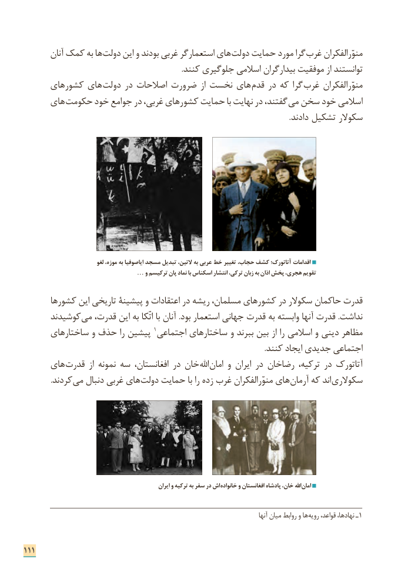

# PDF page 119

آنان کمک به ها دولت این و بودند غربی استعمارگر های دولت حمایت مورد گرا غرب منوّرالفکران
                                                                                     .کنند جلوگیری اسالمی بیدارگران موفقیت از توانستند
      کشورهای های  دولت در اصالحات ضرورت از نخست های  قدم در که گرا غرب منوّرالفکران
      های حکومت خود جوامع در غربی، کشورهای حمایت با نهایت در گفتند، می سخن خود اسالمی
                                                                                                                                              .دادند تشکیل سکوالر

                               لغو موزه، به ایاصوفیا مسجد تبدیل التین، به عربی خط تغییر حجاب، کشف آتاتورک؛ اقدامات
                 … و ترکیسم پان نماد با اسکناس انتشار ترکی، زبان به اذان پخش هجری، تقویم

      کشورها این تاریخی پیشینة و اعتقادات در ریشه مسلمان، کشورهای در سکوالر حاکمان قدرت
      کوشیدند می قدرت، این به اتّکا با آنان .بود استعمار جهانی قدرت به وابسته آنها قدرت .نداشت
      ساختارهای و حذف را پیشین 1اجتماعی ساختارهای و ببرند بین از را اسالمی و دینی مظاهر
                                                                                                                                 .کنند ایجاد جدیدی اجتماعی
      های قدرت  از نمونه سه افغانستان، در خان اهلل امان و ایران در رضاخان ترکیه، در آتاتورک
  . کردند می دنبال غربی های دولت حمایت با را زده غرب منوّرالفکران های آرمان که اند سکوالری

                                                          ایران و ترکیه به سفر در اش خانواده و افغانستان پادشاه خان، اهلل امان

                                                                                                         آنها میان روابط و ها رویه قواعد، نهادها، ـ 1

111

