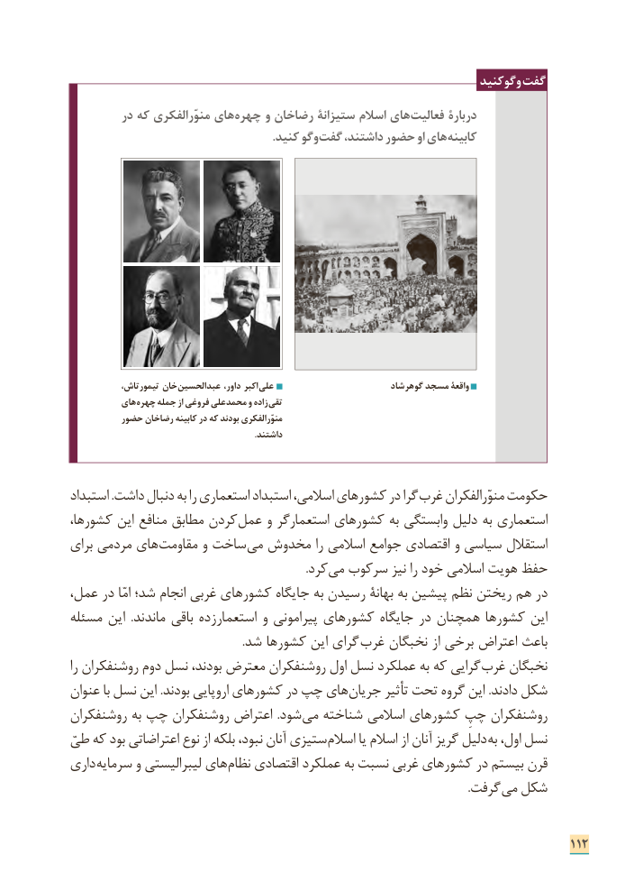

# PDF page 120

وگوکنید گفت
         در كه منوّرالفكری های چهره و رضاخان ستیزانة اسالم های فعالیت دربارۀ
                                                                    .كنید وگو گفت داشتند، حضور او های كابینه

    ،خانتیمورتاش         عبدالحسین داور، اکبر علی                         گوهرشاد مسجد واقعۀ
          های چهره جمله از فروغی محمدعلی و زاده تقی
         حضور رضاخان کابینه در که بودند منوّرالفکری
                                                                                      .داشتند

استبداد .داشت دنبال به را استعماری استبداد اسالمی، کشورهای در گرا غرب منوّرالفکران حکومت
کشورها، این منافع مطابق کردن عمل و استعمارگر کشورهای به وابستگی دلیل به استعماری
برای مردمی های مقاومت و ساخت می مخدوش را اسالمی جوامع اقتصادی و سیاسی استقالل
                  . کرد می سرکوب نیز را خود اسالمی هویت حفظ
عمل، در امّا شد؛ انجام غربی کشورهای جایگاه به رسیدن بهانة به پیشین نظم ریختن هم در
مسئله این  .ماندند باقی استعمارزده و پیرامونی کشورهای جایگاه در همچنان کشورها این
   . شد کشورها این گرای غرب نخبگان از برخی اعتراض باعث
را روشنفکران دوم نسل بودند، معترض روشنفکران اول نسل عملکرد به که گرایی غرب نخبگان
عنوان با نسل این .بودند اروپایی کشورهای در چپ های جریان تأثیر تحت گروه این .دادند شکل
روشنفکران به چپ روشنفکران اعتراض  .شود می شناخته اسالمی کشورهای چپِ روشنفکران
طیّ که بود اعتراضاتی نوع از بلکه نبود، آنان ستیزی اسالم یا اسالم از آنان گریز دلیل به اول، نسل
داری سرمایه و لیبرالیستی های نظام اقتصادی عملکرد به نسبت غربی کشورهای در بیستم قرن
                     . گرفت می شکل

                                                                              112

