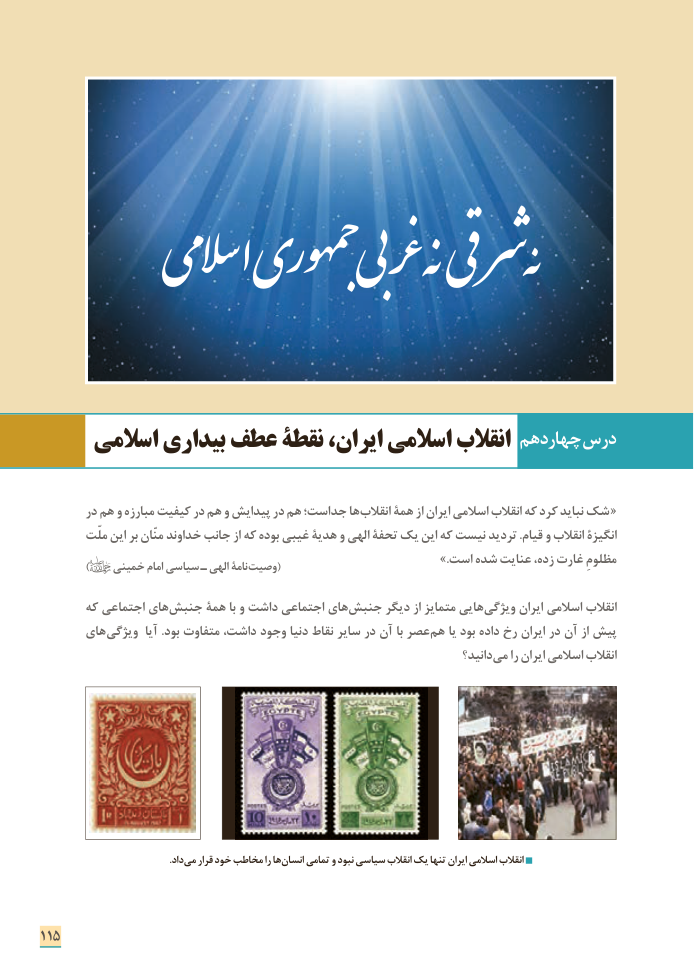

# PDF page 123

ƕ      میاسال یجمهوربی رغ هن قی نهشر

                                                      چهاردهم درس     اسالمی بیداری عطف نقطۀ ایران، اسالمی انقالب

        در هم و مبارزه کیفیت در هم و پیدایش در هم جداست؛ ها انقالب همۀ از ایران اسالمی انقالب که کرد نباید شک «
        ملّت این بر منّان خداوند جانب از که بوده غیبی هدیۀ و الهی تحفۀ یک این که نیست تردید .قیام و انقالب انگیزۀ
                                                                                         .»است شده عنایت زده، غارت مظلومِ          )    خمینی امام سیاسی ـ الهی نامۀ (وصیت

       که اجتماعی های جنبش همۀ با و داشت اجتماعی های­ جنبش دیگر از متمایز هایی ­ویژگی ایران اسالمی انقالب
       های ­ویژگی  آیا .بود متفاوت داشت، وجود دنیا نقاط سایر در آن با عصر هم یا بود داده رخ ایران در آن از پیش
                                                                                   دانید؟ می را ایران اسالمی انقالب

                                                      .داد می قرار خود مخاطب را ها انسان تمامی و نبود سیاسی انقالب یک تنها ایران اسالمی انقالب

115

