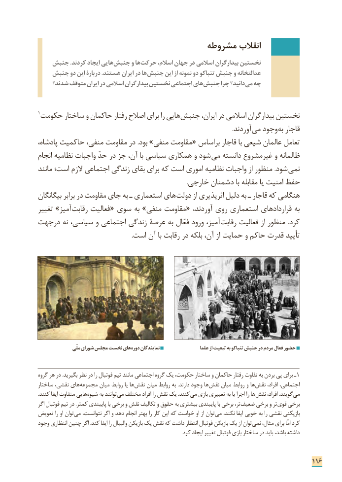

# PDF page 124

مشروطه انقالب
   جنبش .کردند ایجاد هایی ­جنبش و ها ­حرکت اسالم، جهان در اسالمی بیدارگران نخستین
   جنبش دو این دربارۀ .هستند ایران در ها جنبش این از نمونه دو تنباکو جنبش و عدالتخانه
    شدند؟ متوقف ایران در اسالمی بیدارگران نخستین اجتماعی های جنبش چرا دانید؟ می چه

1حکومت ساختار و حاکمان رفتار اصالح برای را هایی ­جنبش ایران، در اسالمی بیدارگران نخستین
                                                                                                                            .آوردند می وجود به قاجار
پادشاه، حاکمیت منفی، مقاومت در .بود »منفی مقاومت « براساس قاجار با شیعی عالمان تعامل
انجام نظامیه واجبات حدّ در جز آن، با سیاسی همکاری و شود­ می دانسته غیرمشروع و ظالمانه
مانند است؛ الزم اجتماعی زندگی بقای برای که است اموری نظامیه واجبات از منظور .شود­ نمی
                                                                                               .خارجی دشمنان با مقابله یا امنیت حفظ
بیگانگان برابر در مقاومت جای به ـ استعماری های­ دولت از اثرپذیری دلیل به ـ قاجار که هنگامی
تغییر »آمیز رقابت فعالیت « سوی به »منفی مقاومت « ،بهآوردند روی استعماری قراردادهای
درجهت نه سیاسی، و اجتماعی زندگی عرصة به فعّال ورود آمیز، رقابت فعالیت از منظور  .کرد
                                                            .است آن با رقابت در بلکه آن، از حمایت و حاکم قدرت تأیید

                 ملّی شورای مجلس نخست های دوره نمایندگان                   علما از تبعیت به تنباکو جنبش در مردم فعال حضور

گروه هر در .بگیرید نظر در را فوتبال تیم مانند اجتماعی گروه یک حکومت، ساختار و حاکمان رفتار تفاوت به بردن پی برای ـ 1
ساختار نقشی، های مجموعه میان روابط یا ها نقش میان روابط به .دارند وجود ها ­نقش میان روابط و ها­ نقش افراد، اجتماعی،
.کنند ایفا متفاوت هایی شیوه به توانند­ می مختلف افراد را نقش یک .کنند ­می بازی تعبیری به یا اجرا را ها ­نقش افراد، .گویند می
اگر فوتبال تیم در .کمتر پایبندی با برخی و نقش تکالیف و حقوق به بیشتری پایبندی با برخی تر،­ ضعیف برخی و تر­ قوی برخی
تعویض را او توان­ می نتوانست، اگر و دهد انجام بهتر را کار این که خواست او از توان­ می نکند، ایفا خوبی به را نقشی بازیکنی
وجود انتظاری چنین اگر .کند ایفا را والیبال بازیکن یک نقش که داشت انتظار فوتبال بازیکن یک از توان ­نمی مثال، برای امّا کرد
                                                                                                                       .کرد ایجاد تغییر فوتبال بازی ساختار در باید باشد، داشته

                                                                              116

