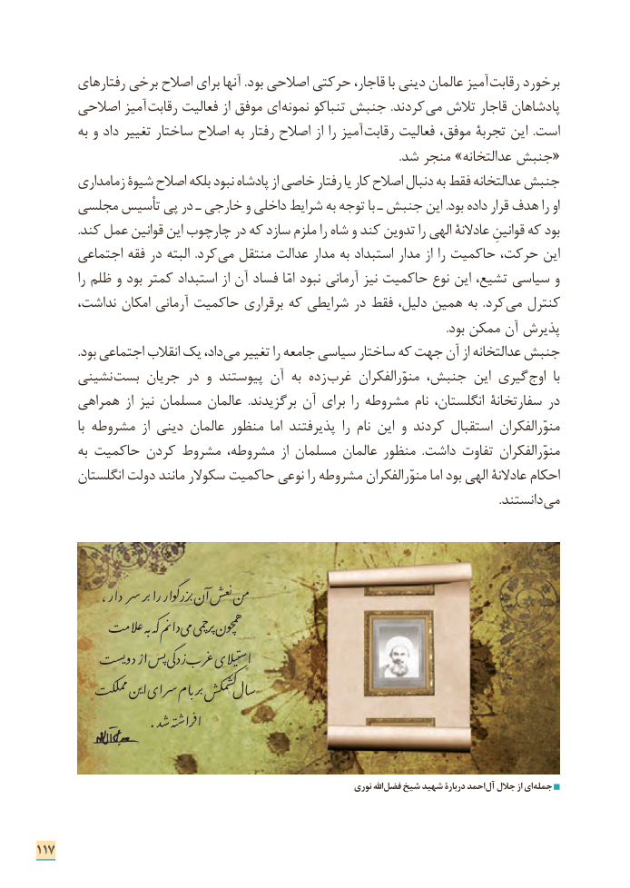

# PDF page 125

رفتارهای برخی اصالح برای آنها .بود اصالحی حرکتی قاجار، با دینی عالمان آمیز  رقابت برخورد
      اصالحی آمیز  رقابت فعالیت از موفق ای ­ نمونه تنباکو جنبش .کردند  می تالش قاجار پادشاهان
        به و داد تغییر ساختار اصالح به رفتار اصالح از را آمیز رقابت فعالیت موفق، تجربة این  .است
                                                                                                                              .شد منجر »عدالتخانه جنبش«
       زمامداری شیوة اصالح بلکه نبود پادشاه از خاصی رفتار یا کار اصالح دنبال به فقط عدالتخانه جنبش
     مجلسی تأسیس پی در ـ خارجی و داخلی شرایط به توجه با ـ جنبش این .بود داده قرار هدف را او
              .کند عمل قوانین این چارچوب در که سازد ملزم را شاه و کند تدوین را الهی عادالنة قوانینِ که بود
      اجتماعی فقه در البته  .کرد می منتقل عدالت مدار به استبداد مدار از را حاکمیت حرکت، این
          را ظلم و بود کمتر استبداد از آن فساد  امّا نبود آرمانی نیز حاکمیت نوع این تشیع، سیاسی و
      نداشت، امکان آرمانی حاکمیت برقراری که شرایطی در فقط دلیل، همین به  .کرد می کنترل
                                                                                                                                                 .بود ممکن آن پذیرش
 . ­بود اجتماعی انقالب یک داد، می تغییر را جامعه سیاسی ساختار که جهت آن از عدالتخانه جنبش
      نشینی بست جریان در و پیوستند آن به زده غرب منوّرالفکران جنبش، این گیری اوج  با
      همراهی از نیز مسلمان عالمان  .برگزیدند آن برای را مشروطه نام انگلستان، سفارتخانة در
            با مشروطه  از دینی عالمان منظور  اما پذیرفتند  را نام این و کردند استقبال منوّرالفکران
        به حاکمیت کردن مشروط مشروطه، از مسلمان عالمان منظور  .داشت تفاوت منوّرالفکران
       انگلستان دولت مانند سکوالر حاکمیت نوعی را مشروطه منوّرالفکران اما بود الهی عادالنة احکام
                   . دانستند می

                                                                                                    ŭ                                                                        ŭ             ،ردا  سررِابر           ن� �Ų من                        ر گوارɁ �نع
                                         هم                                                                                                                                         ˗    ĭŵعالم بهŷ کهɉ نم دا می چمیƞپرŭ ون
                                                                                                                                                                                     Ɍ        ȃغر یالیساʲӓ              دô ñ    ĭŮیسŮدوôا پس گی                                                                                     ɀ                                                                   Ŷ                                                      Ίم̆ال س   ĮΆممل ین                           ا سرای بامŨ برŭ�
                     .دƤ تهˁ�فراȡا

                                                                        نوری اهلل فضل شیخ شهید دربارة احمد آل جالل از ای جمله

117

