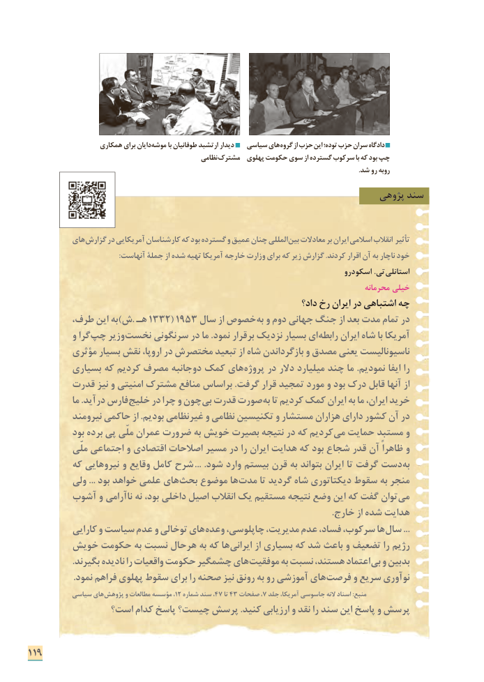

# PDF page 127

همکاری برای دایان موشه با طوفانیان ارتشبد دیدار   سیاسی های گروه از حزب این توده؛ حزب سران دادگاه
                                                   نظامی مشترک  پهلوی حکومت سوی از گسترده سرکوب با که بود چپ
                                                                                                                                                                                                     .شد رو روبه
                                                                     پژوهی سند

          های گزارش در آمریکایی کارشناسان که بود گسترده و عمیق چنان المللی بین معادالت بر ایران اسالمی انقالب تأثیر
                                                :آنهاست جملۀ از شده تهیه آمریکا خارجه وزارت برای که زیر گزارش .کردند اقرار آن به ناچار خود
                                                                               اسکودرو .تی  استانلی
                                                                                             محرمانه خیلی
                                                                     داد؟ رخ ایران در اشتباهی چه
        طرف، این به)ش. هـ١٣٣٢( 1953 سال از خصوص به و دوم جهانی جنگ از بعد مدت تمام در
          و گرا چپ وزیر نخست سرنگونی در ما .نمود برقرار نزدیک بسیار ای رابطه ایران شاه با آمریکا
         مؤثری بسیار نقش اروپا، در مختصرش تبعید از شاه بازگرداندن و مصدق یعنی ناسیونالیست
         بسیاری که کردیم مصرف جانبه دو کمک های پروژه در دالر میلیارد چند ما .نمودیم ایفا را
        قدرت نیز و امنیتی مشترک منافع براساس .گرفت قرار تمجید مورد و بود درک قابل آنها از
            ما .درآید فارس خلیج در چرا و چون بی قدرت صورت به تا کردیم کمک ایران به ما ایران، خرید
          نیرومند حاکمی از .بودیم غیرنظامی و نظامی تکنیسین و مستشار هزاران دارای کشور آن در
           بود برده پی ملّی عمران ضرورت به خویش بصیرت نتیجه در که کردیم می حمایت مستبد و
            ملّی اجتماعی و اقتصادی اصالحات مسیر در را ایران هدایت که بود شجاع قدر آن ظاهراً و
         که نیروهایی و وقایع کامل شرح ... .شود وارد بیستم قرن به بتواند ایران تا گرفت دست به
         ولی ... بود خواهد علمی های بحث موضوع ها مدت تا گردید شاه دیکتاتوری سقوط به منجر
       آشوب و ناآرامی نه بود، داخلی اصیل انقالب یک مستقیم نتیجه وضع این که گفت توان می
                                                                                                                                   .خارج از شده هدایت
           کارایی و سیاست عدم و توخالی های وعده چاپلوسی، مدیریت، عدم فساد، سرکوب، ها ...سال
       خویش حکومت به نسبت هرحال به که ها ایرانی از بسیاری که شد باعث و تضعیف را رژیم
                   .بگیرند نادیده را واقعیات حکومت چشمگیر های موفقیت به نسبت هستند، اعتماد بی و بدبین
. نمود فراهم پهلوی سقوط برای را صحنه نیز رونق به رو آموزشی های فرصت و سریع نوآوری
           سیاسی های پژوهش و مطالعات مؤسسه ،12 شماره سند ،47 تا 43 صفحات ،7 جلد آمریکا، جاسوسی النه اسناد :منبع
               است؟ کدام پاسخ چیست؟ پرسش .کنید ارزیابی و نقد را سند این پاسخ و پرسش

119

