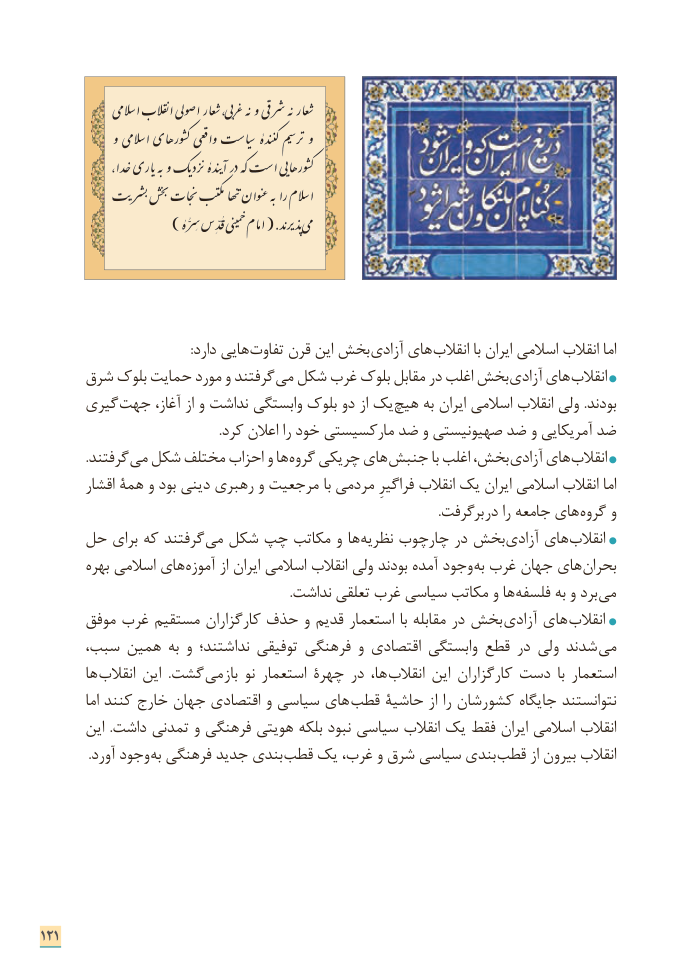

# PDF page 129

:دارد هایی تفاوت قرن این بخش آزادی های ­انقالب با ایران اسالمی انقالب اما
     شرق بلوک حمایت مورد و گرفتند ­می شکل غرب بلوک مقابل در اغلب بخش آزادی های ­انقالب
      گیری ­جهت آغاز، از و نداشت وابستگی بلوک دو از یک هیچ به ایران اسالمی انقالب ولی .بودند
                                                        .کرد اعالن را خود مارکسیستی ضد و صهیونیستی ضد و آمریکایی ضد
              .گرفتند می شکل مختلف احزاب و ها ­گروه چریکی های ­جنبش با اغلب بخش، آزادی های انقالب
        اقشار همۀ و بود دینی رهبری و مرجعیت با مردمی فراگیرِ انقالب یک ایران اسالمی انقالب اما
                . گرفتبر در را جامعه های گروه و
    حل برای که گرفتند­ می شکل چپ مکاتب و ها ­نظریه چارچوب در بخش آزادی های ­انقالب
        بهره اسالمی های آموزه از ایران اسالمی انقالب ولی بودند آمده وجود به غرب جهان های­ بحران
                                                                               .نداشت تعلقی غرب سیاسی مکاتب و ها­ فلسفه به و برد­ می
      موفق غرب مستقیم کارگزاران حذف و قدیم استعمار با مقابله در بخش  آزادی های ­انقالب
،شدندسبب همین به و نداشتند؛ توفیقی فرهنگی و اقتصادی وابستگی قطع در ولی         می
       ها­ انقالب این  .گشت ­می باز نو استعمار چهرة در ها،  ­انقالب این کارگزاران دست  با استعمار
          اما کنند خارج جهان اقتصادی و سیاسی های ­قطب حاشیة از را کشورشان جایگاه نتوانستند
       این  .داشت تمدنی و فرهنگی هویتی بلکه نبود سیاسی انقالب یک فقط ایران اسالمی انقالب
               .آورد وجود به فرهنگی جدید بندی قطب یک غرب، و شرق سیاسی بندی قطب از بیرون انقالب

121

