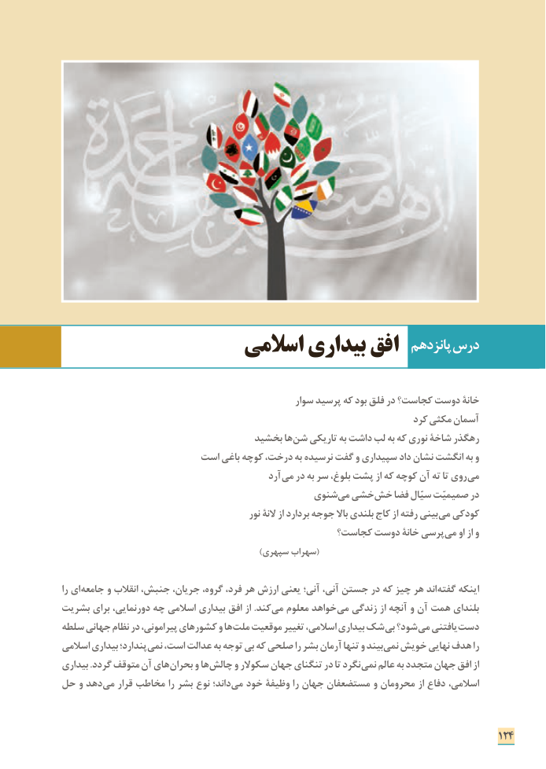

# PDF page 132

پانزدهم درس                  اسالمی بیداری افق

                                                  سوار پرسید که بود فلق در کجاست؟ دوست خانة
                                                                        کرد مکثی آسمان
                                  بخشید ها شن تاریکی به داشت لب به که نوری شاخۀ رهگذر
                      است باغی کوچه درخت، به نرسیده گفت و سپیداری داد نشان انگشت به و
                                               آرد می در به سر بلوغ، پشت از که کوچه آن ته تا روی می
                                          شنویمی‌ خشیخش‌   فضا سیّال صمیمیّت در
                                                نور النة از بردارد جوجه باال بلندی کاج از رفته بینی می کودکی
                                              کجاست؟ دوست خانۀ پرسی می او از و
                                                         )سپهری سهراب(

را ای جامعه و انقالب جنبش، جریان، گروه، فرد، هر ارزش یعنی آنی؛ آنی، جستن در که چیز هر اند گفته اینکه
بشریت برای دورنمایی، چه اسالمی بیداری افق از .کند می معلوم خواهد می زندگی از آنچه و آن همت بلندای
سلطه جهانی نظام در پیرامونی، کشورهای و ها ملت موقعیت تغییر اسالمی، بیداری شک بی شود؟ می یافتنی دست
اسالمی بیداری پندارد؛ نمی است، عدالت به توجه بی که صلحی را بشر آرمان تنها و بیند نمی خویش نهایی هدف را
بیداری .گردد متوقف آن های بحران و ها چالش و سکوالر جهان تنگنای در تا نگرد نمی عالم به متجدد جهان افق از
حل و دهد می قرار مخاطب را بشر نوع داند؛ می خود وظیفة را جهان مستضعفان و محرومان از دفاع اسالمی،

                                                                              124

