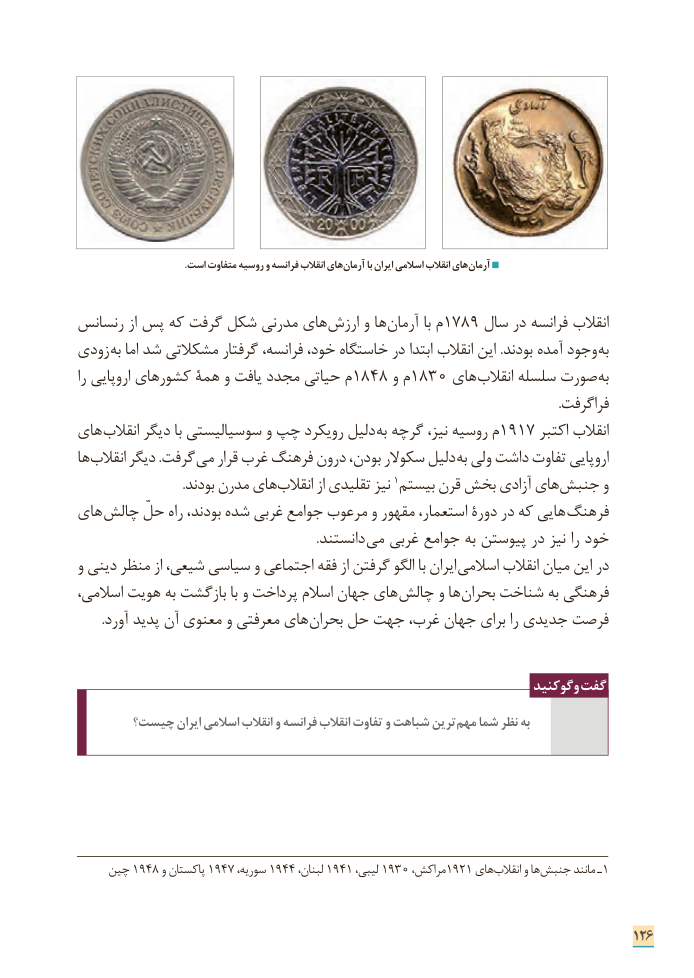

# PDF page 134

.است متفاوت روسیه و فرانسه انقالب های آرمان با ایران اسالمی انقالب های آرمان

رنسانس از پس که گرفت شکل مدرنی های ارزش و ها آرمان با م 1789 سال در فرانسه انقالب
زودی به اما شد مشکالتی گرفتار فرانسه، خود، خاستگاه در ابتدا انقالب این .بودند آمده وجود به
را اروپایی کشورهای همة و یافت مجدد حیاتی م 1848 و م 1830 های ­انقالب سلسله صورت به
                                                                                                                                                       .فراگرفت
های ­انقالب دیگر با سوسیالیستی و چپ رویکرد دلیل به گرچه نیز، روسیه م 1917 اکتبر انقالب
ها ­انقالب دیگر .گرفت می قرار غرب فرهنگ درون بودن، سکوالر دلیل به ولی داشت تفاوت اروپایی
   . ­بودند مدرن های انقالب از تقلیدی نیز 1بیستم قرن بخش آزادی های جنبش و
های  چالش حلّ راه بودند، شده غربی جوامع مرعوب و مقهور استعمار، دورۀ در که هایی  ­فرهنگ
         . دانستند می غربی جوامع به پیوستن در نیز را خود
و دینی منظر از شیعی، سیاسی و اجتماعی فقه از گرفتن الگو با ایران اسالمی انقالب میان این در
اسالمی، هویت به بازگشت با و پرداخت اسالم جهان های­ چالش و ها بحران شناخت به فرهنگی
. ­آورد پدید آن معنوی و معرفتی های بحران حل جهت غرب، جهان برای را جدیدی فرصت

                                                                     وگوکنید گفت
       چیست؟ ایران اسالمی انقالب و فرانسه انقالب تفاوت و شباهت ترین مهم شما نظر به

    چین 1948 و پاکستان 1947 ،سوریه 1944 ،لبنان 1941 ،لیبی 1930 ،مراکش 1921 های ­انقالب و ها جنبش مانند ـ1

                                                                              126

