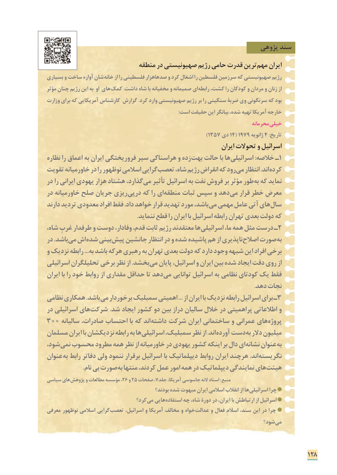

# PDF page 136

پژوهی سند
                           منطقه در صهیونیستی رژیم حامی قدرت ترین مهم ایران
بسیاری و ساخت آواره شان خانه از را فلسطینی صدهاهزار و کرد اشغال را فلسطین سرزمین که صهیونیستی رژیم
مؤثر چنان رژیم این به او های کمک .داشت شاه با مخفیانه و صمیمانه ای رابطه کشت، را کودکان و مردان و زنان از
وزارت برای که آمریکایی کارشناس گزارش .کرد وارد صهیونیستی رژیم بر را سنگینی ضربۀ وی سرنگونی که بود
                                                                                                    :است حقیقت این بیانگر شده، تهیه آمریکا خارجه
                                                                                   محرمانه خیلی
                                                                          )١٣٥٧ دی١٤( ١٩٧٩ ژانویه٤ :تاریخ
                                                                  ایران تحوالت و اسرائیل
نظاره را اعماق به ایران فروریختگی سیر هراسناکی و زده بهت حالت با ها اسرائیلی١:خالصه ـ
تقویت خاورمیانه در را نوظهور اسالمی گرایی تعصب شاه، رژیم انقراض که رود می انتظار .اند کرده
در را ایرانی یهودی هزار هشتاد گذارد، می تأثیر اسرائیل به نفت فروش بر مؤثر طور به که نماید
در خاورمیانه صلح جریان ریزی درپی که را ای منطقه ثبات سپس و دهد می قرار خطر معرض
دارند تردید معدودی افراد فقط .داد خواهد قرار تهدید مورد باشد، می مهمی عامل آتی های سال
                                                        .ننماید قطع را ایران با اسرائیل رابطه تهران بعدی دولت که
شاه، غربِ طرفدار و دوست وفادار، قدم، ثابت رژیم معتقدند ها اسرائیلی٢ما، همه مثل درست ـ
در .باشد می اش شده بینی پیش جانشین انتظار در و شده پاشیده هم از ناپذیری اصالح صورت به
و نزدیک رابطه ...به باشد هرکه رهبری به تهران بعدی دولت که دارد وجود شبهه این افراد برخی
اسرائیلی تحلیلگران برخی نظر از .بخشد می پایان اسرائیل، و ایران بین شده ایجاد دقت روی از
ایران با را خود روابط از مقداری حداقل تا دهد می توانایی اسرائیل به نظامی کودتای یک فقط
                                                                                                                                 .دهد نجات
نظامی همکاری .باشد می٣برخوردار سمبلیک اهمیتی ... از ایران با نزدیک رابطه اسرائیل برای ـ
در اسرائیلی های شرکت .شد ایجاد کشور دو بین دراز سالیان خالل در پراهمیتی اطالعاتی و
٣اند٠٠ سالیانه صادرات، احتساب با که      داشته شرکت ایران ساختمانی و عمرانی های پروژه
مسلمان ایران با نزدیکشان رابطه به ها اسرائیلی سمبلیک، نظر از .اند آورده دست به دالر میلیون
شود، نمی محسوب مطرود همه نظر از خاورمیانه در یهودی کشور اینکه بر دال ای نشانه عنوان به
عنوان به رابط دفاتر ولی ننمود برقرار اسرائیل با دیپلماتیک روابط ایران هرچند .اند نگریسته
                      .نام بی صورت به منتها کردند، عمل امور همه در دیپلماتیک نمایندگی های هیئت
سیاسی های پژوهش٢و مطالعات مؤسسه ، ٦٢٥و صفحات٧منبع، جلد آمریکا، جاسوسی النه اسناد :
                                               بودند؟ شده مبهوت ایران اسالمی انقالب از ها اسرائیلی چرا
                                  کرد؟ می هایی استفاده چه شاه، دورۀ در ایران، با ارتباطش از اسرائیل
معرفی نوظهور اسالمی گرایی تعصب اسرائیل، و آمریکا مخالف و خواه عدالت و فعال اسالمِ سند، این در چرا
                                                                          شود؟ می

                                                                            128

