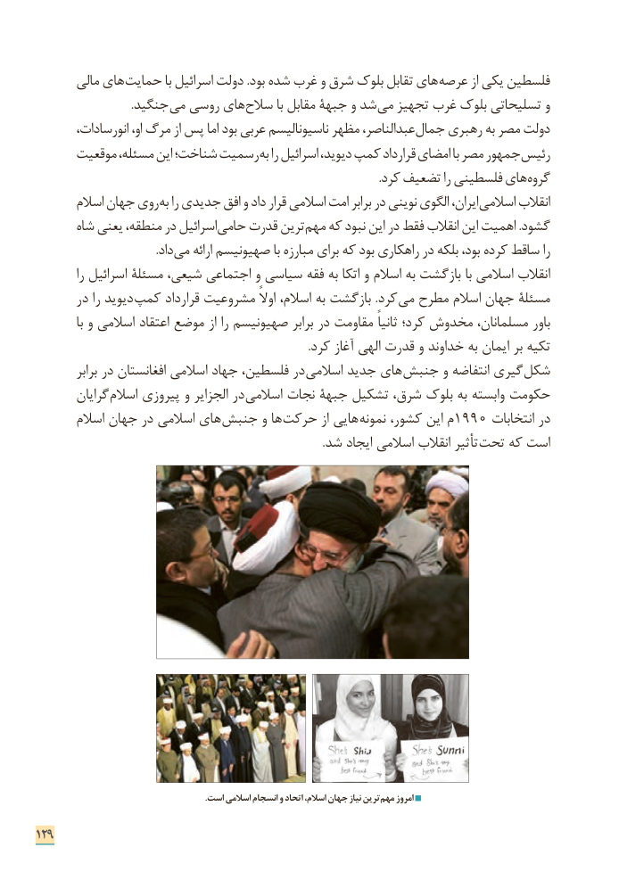

# PDF page 137

مالی های ­حمایت با اسرائیل دولت .بود شده غرب و شرق بلوک تقابل های­ عرصه از یکی فلسطین
                                  .جنگید­ می روسی های­ سالح با مقابل جبهة و شد ­می تجهیز غرب بلوک تسلیحاتی و
        انورسادات، او، مرگ از پس اما بود عربی ناسیونالیسم مظهر عبدالناصر، جمال رهبری به مصر دولت
      موقعیت مسئله، این شناخت؛ رسمیت به را اسرائیل دیوید، کمپ قرارداد امضای با مصر جمهور رئیس
       . ­کرد تضعیف را فلسطینی های گروه
       اسالم جهان روی به را جدیدی افق و داد قرار اسالمی امت برابر در نوینی الگوی ایران، اسالمی انقالب
       شاه یعنی منطقه، در اسرائیل حامی قدرت ترین­ مهم که نبود این در فقط انقالب این اهمیت .گشود
                . ­داد می ارائه صهیونیسم با مبارزه برای که بود راهکاری در بلکه بود، کرده ساقط را
          را اسرائیل مسئلة شیعی، اجتماعی و سیاسی فقه به اتکا و اسالم به بازگشت با اسالمی انقالب
       در را دیوید کمپ قرارداد مشروعیت اوالً اسالم، به بازگشت .کرد­ می مطرح اسالم جهان مسئلۀ
            با و اسالمی اعتقاد موضع از را صهیونیسم برابر در مقاومت ثانیاً کرد؛ مخدوش مسلمانان، باور
                                                                                                .کرد آغاز الهی قدرت و خداوند به ایمان بر تکیه
          برابر در افغانستان اسالمی جهاد فلسطین، در اسالمی جدید های جنبش و انتفاضه گیری شکل
       گرایان اسالم پیروزی و الجزایر در اسالمی نجات جبهة تشکیل شرق، بلوک به وابسته حکومت
       اسالم جهان در اسالمی های­ جنبش و ها حرکت از هایی ­نمونه کشور، این م 1990 انتخابات در
                                                                                                     .شد ایجاد اسالمی انقالب تأثیر تحت که است

                                                                               .است اسالمی انسجام و اتحاد اسالم، جهان نیاز ترین مهم امروز

129

