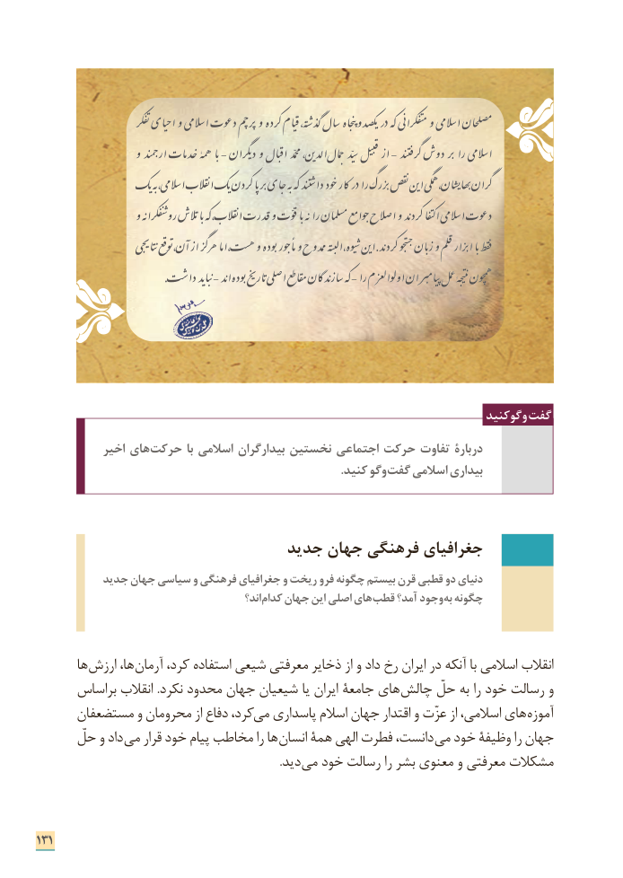

# PDF page 139

وگوکنید گفت
            اخیر های حرکت با اسالمی بیدارگران نخستین اجتماعی حرکت تفاوت دربارۀ
            . کنید وگو گفت اسالمی بیداری

                            جدید جهان فرهنگی جغرافیای
          جدید جهان سیاسی و فرهنگی جغرافیای و ریخت فرو چگونه بیستم قرن قطبی دو دنیای
                                                 اند؟­ کدام جهان این اصلی های ­قطب آمد؟ وجود به چگونه

       ها ارزش ها،­ آرمان کرد، استفاده شیعی معرفتی ذخایر از و داد رخ ایران در آنکه با اسالمی انقالب
      براساس انقالب .نکرد محدود جهان شیعیان یا ایران جامعة های ­چالش حلّ به را خود رسالت و
      مستضعفان و محرومان از دفاع کرد، می پاسداری اسالم جهان اقتدار و عزّت از اسالمی، های آموزه
      حلّ و داد ­می قرار خود پیام مخاطب را ها ­انسان همة الهی فطرت دانست،­ می خود وظیفة را جهان
                            . ­دید می خود رسالت را بشر معنوی و معرفتی مشکالت

131

