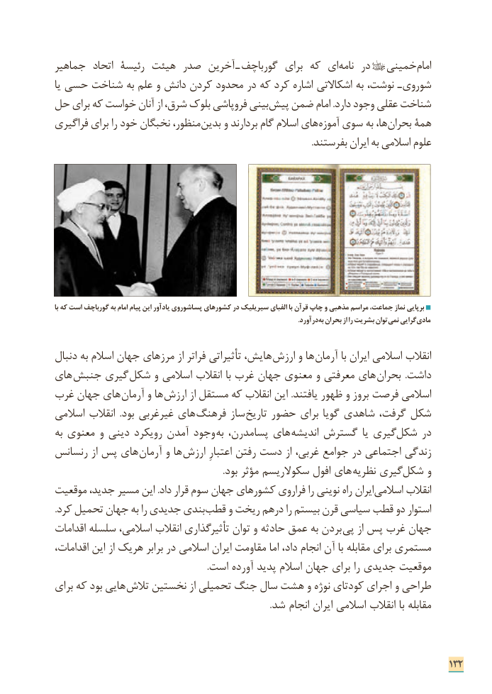

# PDF page 140

جماهیر  اتحاد رئیسة هیئت صدر آخرین ـ گورباچف  برای که ای نامه در      خمینی امام
یا حسی شناخت به علم و دانش کردن محدود در که کرد اشاره اشکاالتی به نوشت،  ـ شوروی
حل برای که خواست آنان از شرق، بلوک فروپاشی بینی پیش ضمن امام .دارد وجود عقلی شناخت
فراگیری برای را خود نخبگان منظور، بدین و بردارند گام اسالم های ­آموزه سوی به ها، بحران همۀ
                                                                                                                  .بفرستند ایران به اسالمی علوم

با که است گورباچف به امام پیام این یادآور پساشوروی کشورهای در سیریلیک الفبای با قرآن چاپ و مذهبی مراسم جماعت، نماز برپایی
                                                                                                                                              .درآورد به بحران از را بشریت توان نمی گرایی مادی

دنبال به اسالم جهان مرزهای از فراتر تأثیراتی هایش، ارزش و ها  آرمان با ایران اسالمی انقالب
های  جنبش گیری ­شکل و اسالمی انقالب با غرب جهان معنوی و معرفتی های ­بحران  .داشت
غرب جهان های آرمان و ها ارزش از مستقل که انقالب این .یافتند ظهور و بروز فرصت اسالمی
اسالمی انقالب  .بود غیرغربی های­ فرهنگ ساز تاریخ حضور برای گویا شاهدی گرفت، شکل
به معنوی و دینی رویکرد آمدن وجود به پسامدرن، های­ اندیشه گسترش یا گیری شکل در
رنسانس از پس های ­ آرمان و ها  ­ارزش اعتبارِ رفتن دست از غربی، جوامع در اجتماعی زندگی
    .­ بود مؤثر سکوالریسم افول های نظریه گیری شکل و
موقعیت جدید، مسیر این .داد قرار سوم جهان کشورهای فراروی را نوینی راه ایران اسالمی انقالب
. ­کرد تحمیل جهان به را جدیدی بندی قطب و ریخت درهم را بیستم قرن سیاسی قطب دو استوار
اقدامات سلسله اسالمی، انقالب تأثیرگذاری توان و حادثه عمق به بردن پی از پس غرب جهان
اقدامات، این از هریک برابر در اسالمی ایران مقاومت اما داد، انجام آن با مقابله برای مستمری
                                                                    .است آورده پدید اسالم جهان برای را جدیدی موقعیت
برای که بود هایی ­ تالش نخستین از تحمیلی جنگ سال هشت و نوژه کودتای اجرای و طراحی
                                                                                               .شد انجام ایران اسالمی انقالب با مقابله

                                                                              132

