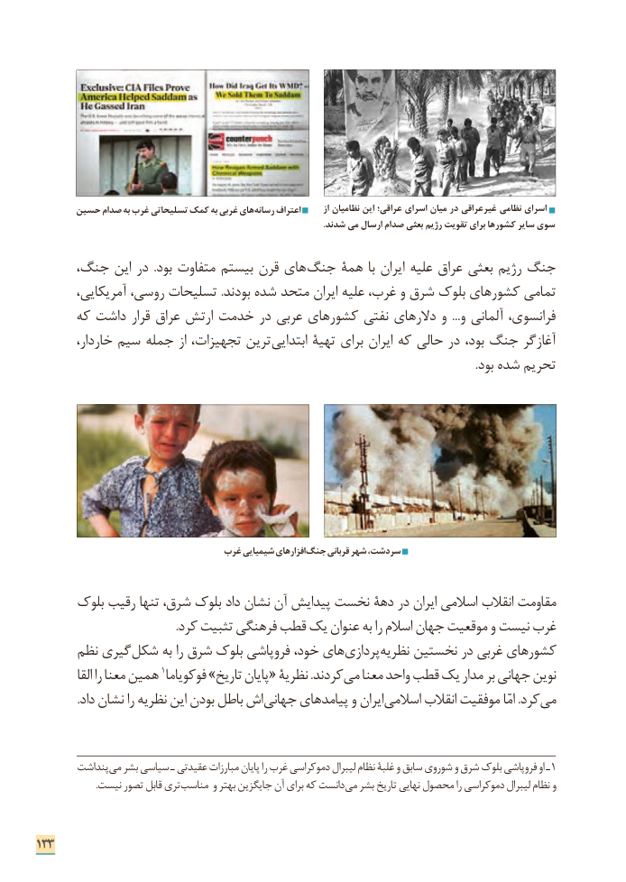

# PDF page 141

حسین صدام به غرب تسلیحاتی کمک به غربی های رسانه اعتراف       از نظامیان این عراقی؛ اسرای میان در غیرعراقی نظامی اسرای
                                                                                                                                    .شدند می ارسال صدام بعثی رژیم تقویت برای کشورها سایر سوی

     جنگ، این در  .بود متفاوت بیستم قرن های­ جنگ همة با ایران علیه عراق بعثی رژیم جنگ
       آمریکایی، روسی، تسلیحات .بودند شده متحد ایران علیه غرب، و شرق بلوک کشورهای تمامی
      که داشت قرار عراق ارتش خدمت در عربی کشورهای نفتی دالرهای و  ...و آلمانی فرانسوی،
        خاردار، سیم جمله از تجهیزات، ترین ابتدایی تهیة برای ایران که حالی در بود، جنگ آغازگر
                                                                                                                                                         .بود شده تحریم

                                غرب شیمیایی افزارهای جنگ قربانی شهر سردشت،

      بلوک رقیب تنها شرق، بلوک داد نشان آن پیدایش نخست دهة در ایران اسالمی انقالب مقاومت
                                                 .کرد تثبیت فرهنگی قطب یک عنوان به را اسالم جهان موقعیت و نیست غرب
      نظم گیری ­شکل به را شرق بلوک فروپاشی خود، های ­پردازی­ نظریه نخستین در غربی کشورهای
           القا را معنا همین 1فوکویاما »تاریخ پایان « نظریة .کردند می معنا واحد قطب یک مدار بر جهانی نوین
. داد نشان را نظریه این بودن باطل اش جهانی پیامدهای و ایران اسالمی انقالب موفقیت امّا .کرد ­می

        پنداشت ­می بشر سیاسی ـ عقیدتی مبارزات پایان را غرب دموکراسی لیبرال نظام غلبة و سابق شوروی و شرق بلوک فروپاشی او ـ 1
                           .نیست تصور قابل تری ­مناسب و بهتر جایگزین آن برای که دانست می بشر تاریخ نهایی محصول را دموکراسی لیبرال نظام و

133

