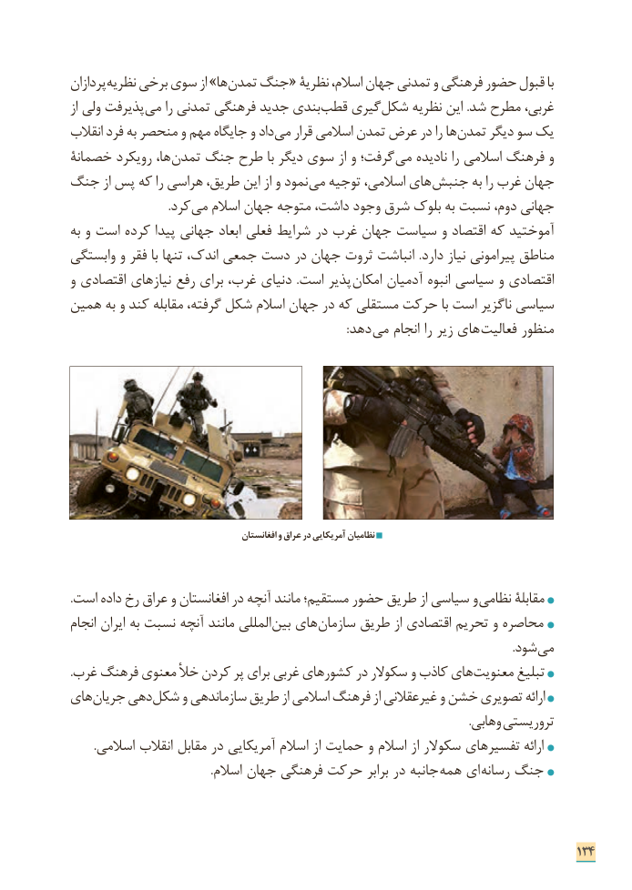

# PDF page 142

پردازان­ نظریه برخی سوی از »ها تمدن جنگ « نظریۀ اسالم، جهان تمدنی و فرهنگی حضور قبول با
از ولی پذیرفت می را تمدنی فرهنگی جدید بندی ­قطب گیری ­شکل نظریه این .شد مطرح غربی،
انقالب فرد به منحصر و مهم جایگاه و داد می قرار اسالمی تمدن عرض در را ها ­تمدن دیگر سو یک
خصمانة رویکرد ها، ­تمدن جنگ طرح با دیگر سوی از و گرفت؛­ می نادیده را اسالمی فرهنگ و
جنگ از پس که را هراسی طریق، این از و نمود ­می توجیه اسالمی، های جنبش به را غرب جهان
           . ­کرد می اسالم جهان متوجه داشت، وجود شرق بلوک به نسبت دوم، جهانی
به و است کرده پیدا جهانی ابعاد فعلی شرایط در غرب جهان سیاست و اقتصاد که آموختید
وابستگی و فقر با تنها اندک، جمعی دست در جهان ثروت انباشت .دارد نیاز پیرامونی مناطق
و اقتصادی نیازهای رفع برای غرب، دنیای  .است پذیر  امکان آدمیان انبوه سیاسی و اقتصادی
همین به و کند مقابله گرفته، شکل اسالم جهان در که مستقلی حرکت با است ناگزیر سیاسی
                            :­ دهد می انجام را زیر های­ فعالیت منظور

                                            افغانستان و عراق در آمریکایی نظامیان

. است داده رخ عراق و افغانستان در آنچه مانند مستقیم؛ حضور طریق از سیاسی و نظامی مقابلة
انجام ایران به نسبت آنچه مانند المللی بین های سازمان طریق از اقتصادی تحریم و محاصره
                                                                                                                                                         .شود ­می
. ­غرب فرهنگ معنوی خأل کردن پر برای غربی کشورهای در سکوالر و کاذب های معنویت تبلیغ
های جریان دهی شکل و سازماندهی طریق از اسالمی فرهنگ از غیرعقالنی و خشن تصویری ارائه
                                                                                                                                          .وهابی تروریستی
        .اسالمی انقالب مقابل در آمریکایی اسالم از حمایت و اسالم از سکوالر تفسیرهای ارائه
                                                .اسالم جهان فرهنگی حرکت برابر در جانبه  همه ای ­رسانه جنگ

                                                                              134

