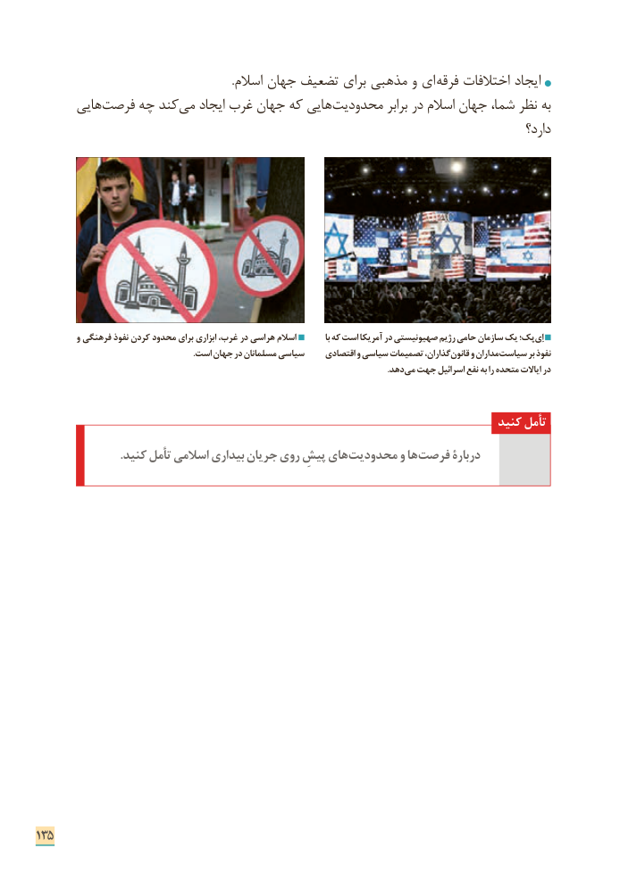

# PDF page 143

.­ اسالم جهان تضعیف برای مذهبی و ای فرقه اختالفات ایجاد
      هایی فرصت چه کند می ایجاد غرب جهان که هایی محدودیت برابر در اسالم جهان شما، نظر به
                                                                                              دارد؟

          و فرهنگی نفوذ کردن محدود برای ابزاری غرب، در هراسی اسالم           با که است آمریکا در صهیونیستی رژیم حامی سازمان یک پک؛ اِی
                                                                         .است جهان در مسلمانان سیاسی     اقتصادی و سیاسی تصمیمات گذاران، قانون و مداران سیاست بر نفوذ
                                     . دهدمی جهت اسرائیل نفع به را متحده ایاالت در

                                                                             کنید تأمل
 . کنید تأمل اسالمی بیداری جریان روی پیشِ های محدودیت و ها فرصت دربارۀ

135

