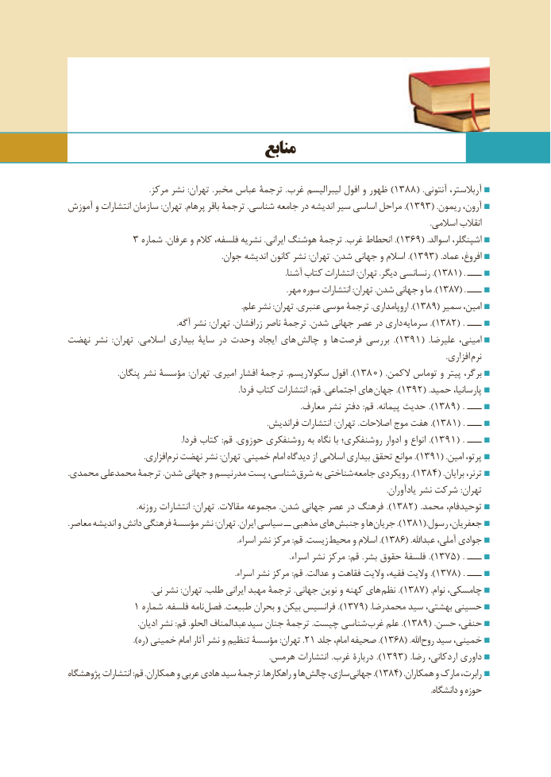

# PDF page 145

منابع

  .1388(مرکز نشر :تهران .مخبر عباس ترجمة .غرب لیبرالیسم افول و ظهور )               .آنتونی آربالستر،
آموزش و انتشارات سازمان :تهران .پرهام باقر ترجمۀ .شناسی جامعه در اندیشه سیر اساسی مراحل ). 1393( .ریمون آرون،
                                                                                                                                                                                          .اسالمی انقالب
            3 شماره .عرفان و کالم فلسفه، نشریه .ایرانی هوشنگ ترجمۀ .غرب انحطاط ). 1369( .اسوالد اشپنگلر،
  .).جوان اندیشه کانون نشر :تهران .شدن جهانی و اسالم  1393( .عماد افروغ،
    .).آشنا کتاب انتشارات :تهران .دیگر رنسانسی 1381( . ــــ
    .).مهر سوره انتشارات :تهران .شدن جهانی و ما 1387( . ــــ
   .).علم نشر :تهران .عنبری موسی ترجمۀ .اروپامداری 1389( سمیر امین،
                                                        .آگه نشر :تهران .زرافشان ناصر ترجمۀ .شدن جهانی عصر در داری ).سرمایه  1382( . ــــ
نهضت نشر  :تهران  .اسالمی بیداری سایۀ در وحدت ایجاد های چالش و ها ).فرصت بررسی  1391(  .علیرضا امینی،
                                                                                                                                                                                                   .افزاری نرم
 .1380(پنگان نشر مؤسسة :تهران .امیری افشار ترجمۀ .سکوالریسم افول ).               .الکمن توماس و پیتر برگر،
                                                                                        .فردا کتاب انتشارات :قم .اجتماعی های ).جهان  1392( .حمید پارسانیا،
     .).معارف نشر دفتر :قم .پیمانه حدیث  1389( . ــــ
    .).فراندیش انتشارات :تهران .اصالحات موج هفت  1381( . ــــ
 .).فردا کتاب :قم .حوزوی روشنفکری به نگاه با روشنفکری؛ ادوار و انواع  1391( . ــــ
                                       .افزاری ).نرم نهضت نشر :تهران .خمینی امام دیدگاه از اسالمی بیداری تحقق موانع 1391( .امین پرتو،
.محمدی محمدعلی ترجمۀ .شدن جهانی و مدرنیسم پست شناسی، شرق به شناختی ).جامعه رویکردی 1384( .برایان ترنر،
                                                                                                                                                                    .یادآوران نشر شرکت :تهران
 .1382(روزنه انتشارات :تهران  .مقاالت مجموعه .شدن جهانی عصر در فرهنگ ).               .محمد توحیدفام،
.معاصر اندیشه و دانش فرهنگی مؤسسۀ نشر :تهران .ایران سیاسی ــ مذهبی های جنبش و ها ).جریان 1381(.رسول جعفریان،
                                                                                       .اسراء نشر مرکز :قم .زیست ).محیط و اسالم 1386( .عبداهلل آملی، جوادی
     .).اسراء نشر مرکز :قم .بشر حقوق فلسفة  1375( . ــــ
  .).اسراء نشر مرکز :قم .عدالت و فقاهت والیت فقیه، والیت  1378( . ــــ
                                           .نی نشر :تهران .طلب ایرانی مهبد ترجمۀ .جهانی نوین و کهنه های ).نظم  1387( .نوام چامسکی،
            1 شماره .فلسفه نامه ).فصل .طبیعت بحران و بیکن فرانسیس 1379( .محمدرضا سید بهشتی، حسینی
                                    .ادیان نشر :قم .الحلو عبدالمناف سید جنان ترجمۀ .چیست شناسی ).غرب علم 1389( .حسن حنفی،
 .)2.ره( خمینی امام آثار نشر و تنظیم مؤسسۀ :تهران  1 جلد امام، صحیفه ). 1368( .اهلل روح سید خمینی،
     .).هرمس انتشارات .غرب دربارۀ  1393( .رضا اردکانی، داوری
پژوهشگاه انتشارات :قم .همکاران و عربی هادی سید ترجمۀ .راهکارها و ها چالش سازی، ).جهانی 1384( .همکاران و مارک رابرت،
                                                                                                                                                                                           .دانشگاه و حوزه

