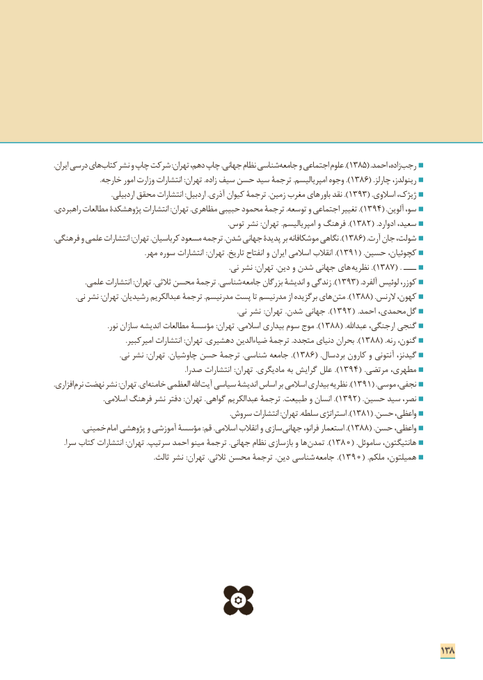

# PDF page 146

.ایران درسی های کتاب نشر و چاپ شرکت :تهران دهم، چاپ .جهانی نظام شناسی ).جامعه و اجتماعی علوم 1385( .احمد زاده، رجب
                           .خارجه امور وزارت انتشارات :تهران .زاده سیف حسن سید ترجمۀ .امپریالیسم وجوه ). 1386( .چارلز رینولدز،
                                  .اردبیلی محقق انتشارات :اردبیل .آذری کیوان ترجمۀ .زمین مغرب های ).باور نقد 1393( .اسالوی ژیژک،
.).راهبردی مطالعات پژوهشکدة انتشارات :تهران .مظاهری حبیبی محمود ترجمۀ .توسعه و اجتماعی تغییر 1394( .آلوین سو،
    .).توس نشر :تهران .امپریالیسم و فرهنگ  1382( .ادوارد سعید،
.).فرهنگی و علمی انتشارات :تهران .کرباسیان مسعود ترجمه .شدن جهانی پدیدۀ بر موشکافانه نگاهی 1386( .آرت جان شولت،
 .).مهر سوره انتشارات :تهران .تاریخ انفتاح و ایران اسالمی انقالب  1391( .حسین کچوئیان،
                                                                                                       .نی نشر :تهران .دین و شدن جهانی های ).نظریه  1387( . ــــ
                   .علمی انتشارات :تهران .ثالثی محسن ترجمة .شناسی ).جامعه بزرگان اندیشۀ و زندگی 1393( .آلفرد لوئیس کوزر،
             .نی نشر :تهران .رشیدیان عبدالکریم ترجمۀ .مدرنیسم پست تا مدرنیسم از برگزیده های ).متن 1388( .الرنس کهون،
      .).نی نشر :تهران .شدن جهانی  1392( .احمد محمدی،  گل
 .).نور سازان اندیشه مطالعات مؤسسة :تهران .اسالمی بیداری سوم موج  1388( .عبداهلل ارجنگی، گنجی
 .).امیرکبیر انتشارات :تهران .دهشیری ضیاءالدین ترجمۀ .متجدد دنیای بحران 1388( .رنه گنون،
 .).نی نشر :تهران .چاوشیان حسن ترجمۀ .شناسی جامعه  1386( .بردسال کارون و آنتونی گیدنز،
   .).صدرا انتشارات :تهران .مادیگری به گرایش علل  1394( .مرتضی مطهری،
.افزاری نرم نهضت نشر :تهران .ای خامنه العظمی اهلل ).آیت سیاسی اندیشۀ اساس بر اسالمی بیداری نظریه 1391( .موسی نجفی،
 .).اسالمی فرهنگ نشر دفتر :تهران .گواهی عبدالکریم ترجمۀ .طبیعت و انسان  1392( .حسین سید نصر،
    .).سروش انتشارات :تهران .سلطه استراتژی 1381( .حسن واعظی،
                 .خمینی امام پژوهشی و آموزشی مؤسسة :قم .اسالمی انقالب و سازی ).جهانی فرانو، استعمار 1388( .حسن واعظی،
      .سرا کتاب انتشارات :تهران .سرتیپ احمد مینو ترجمۀ .جهانی نظام بازسازی و ها ).تمدن 1380( .ساموئل هانتیگتون،
                                                           .ثالث نشر :تهران .ثالثی محسن ترجمۀ .دین شناسی ).جامعه  1390( .ملکم همیلتون،

                                                                              138

