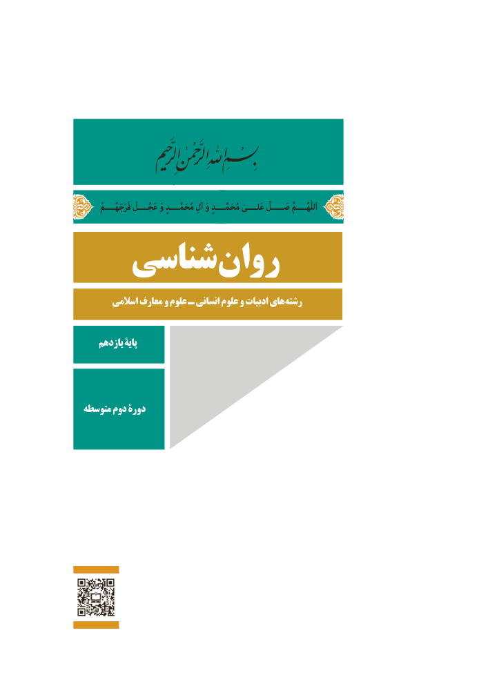

# PDF page 1

ْاَللّٰهُــــمَّفَرَجَهُــــم عَجِّــــلْ وَ مُحَمَّــــدٍ آلِ وَ مُحَمَّــــدٍ عَلــــیٰ صَـــــلِّ
   شناسی روان
       اسالمی معارف و علوم ـ انسانی علوم و ادبیات های رشته

    یازدهم پایۀ

متوسطه دوم دورۀ

