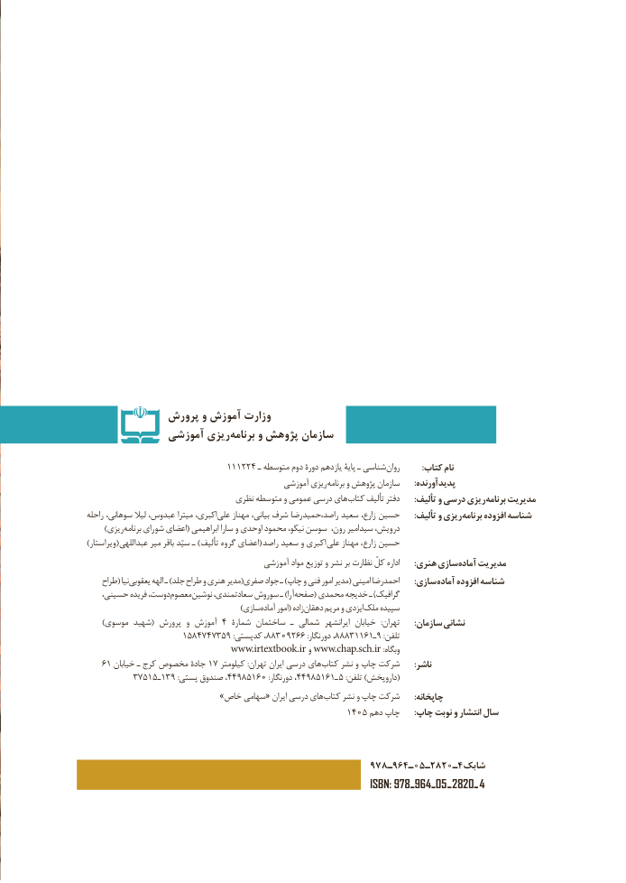

# PDF page 2

پرورش و آموزش وزارت
             آموزشي ريزي‌برنامه و پژوهش سازمان

                             111224 ـ متوسطه دوم دورۀ یازدهم پایۀ ـ شناسی روان          :کتاب نام
                                               آموزشی ریزی برنامه و پژوهش سازمان       :پدیدآورنده
                                نظری متوسطه و عمومی درسی های کتاب تألیف دفتر : تألیف و درسی ریزی برنامه مدیریت
راحله سوهانی، لیال عبدوس، میترا اکبری، علی مهناز بیانی، شرف راصد،حمیدرضا سعید زارع، حسین       :تألیف و ریزی برنامه افزوده شناسه
      )ریزی برنامه شورای اعضای( ابراهیمی سارا و اوحدی محمود نیکو، سوسن رون، سیدامیر درویش،
) ویراستار(عبداللهی میر باقر سیّد ـ )تألیف گروه اعضای( راصد سعید و اکبری  علی مهناز زارع، حسین
                                          آموزشی مواد توزیع و نشر بر نظارت کلّ اداره       :هنری سازیآماده‌    مدیریت
    طراح( نیا یعقوبی الهه ـ )جلد طراح و هنری مدیر(صفری جواد ـ )چاپ و فنی امور مدیر( امینی احمدرضا : سازی آماده افزوده شناسه
   حسینی، فریده دوست، معصوم نوشین سعادتمندی،  سوروش ـ )آرا صفحه( محمدی خدیجه ـ )گرافیک
              ) سازیآماده امور( زاده دهقان مریم و ایزدی ملک سپیده
     )موسوی شهید( پرورش و آموزش ٤ شمارۀ ساختمان ـ شمالی  ایرانشهر خیابان   :تهران       :سازمان نشانی
           ١٨٥٤٧٤٩٠٣٨٨،٩٥٣٧٢٣٨٨٨،:کدپستی   ٦٦١١٦١تلفن:دورنگار          ٩ـ :
                                 www.irtextbook.ir و www.chap.sch.ir :وبگاه
   ٦١ خیابان١هایـ کرج مخصوص جادۀ ٧ کیلومتر :تهران ایران درسی       کتاب نشر و چاپ شرکت       :ناشر
          ٥٧٣١٥ ـ١،٩٣ :پستی صندوق 44589106 :دورنگار٤٤٥٨٩١٦١،               ـ (٥ :تلفن )داروپخش
   » خاص سهامی« ایران درسی های کتاب نشر و چاپ شرکت       :چاپخانه
                   :1450دهم چاپ   چاپ نوبت و انتشار سال

                                                 978ـ964ـ05ـ2820ـ4شابك
                                                                  ISBN: 978 ـ 964 ـ  05 ـ  2820 ـ 4

