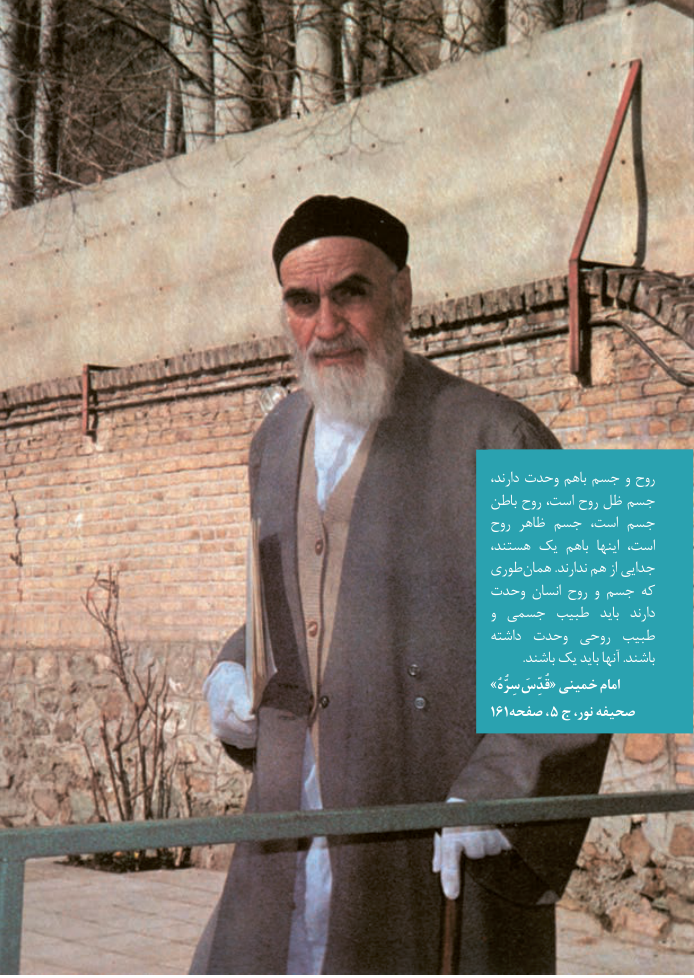

# PDF page 3

،روحدارند وحدت باهم جسم و
باطن روح است، روح ظل جسم
روح ظاهر جسم است، جسم
هستند، یک باهم  اینها است،
طوری همان .ندارند هم از جدایی
وحدت انسان روح و جسم که
و جسمی طبیب  باید  دارند
داشته وحدت روحی طبیب
           .باشند یک باید آنها .باشند
» سِرُّهُ قُدِّسَامام« خمینی
161صفحه ، 5 ج نور، صحیفه

