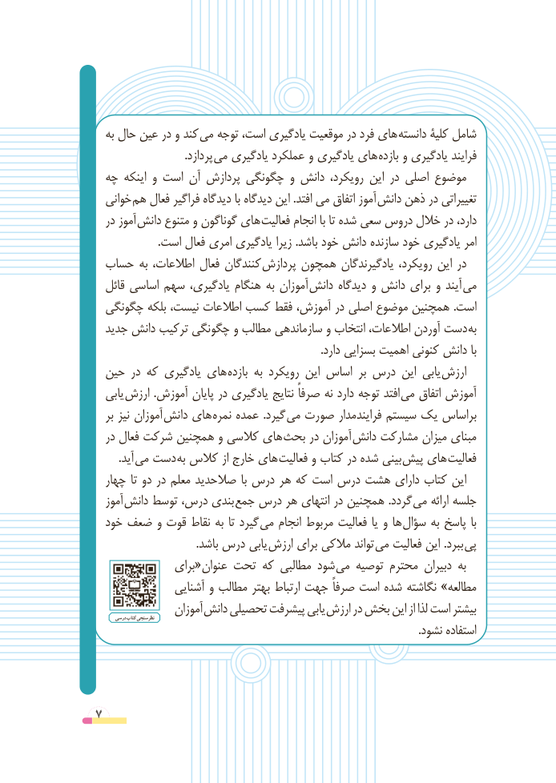

# PDF page 7

به حال عین در و كند می توجه ،است یادگیری موقعیت در فرد های دانسته كلیۀ شامل
                                 .پردازد می یادگیری عملكرد و یادگیری های بازده و یادگیری فرایند
 چه اینكه و است آن پردازش چگونگی و دانش ،رویكرد این در اصلی موضوع
  خوانی هم فعال فراگیر دیدگاه با دیدگاه این .افتد می اتفاق آموز  دانش ذهن در تغییراتی
  در آموز  دانش متنوع و گوناگون های فعالیت انجام با تا شده سعی دروس خالل در ،دارد
                       .است فعال امری یادگیری زیرا .باشد خود دانش سازنده خود یادگیری امر
 حساب به ،اطالعات فعال كنندگان پردازش همچون یادگیرندگان ،رویكرد این در
  قائل اساسی سهم ،یادگیری هنگام به آموزان  دانش دیدگاه و دانش برای و آیند می
 چگونگی بلكه ،نیست اطالعات كسب فقط ،آموزش در اصلی موضوع همچنین .است
  جدید دانش ترکیب چگونگی و مطالب سازماندهی و انتخاب ،اطالعات آوردن دست به
                                                                                  .دارد بسزایی اهمیت كنونی دانش با
 حین در كه یادگیری های بازده به رویكرد این اساس بر درس این یابی ارزش
  یابی ارزش .آموزش پایان در یادگیری نتایج ًصرفا نه دارد توجه افتد می اتفاق آموزش
  بر نیز آموزان  دانش های نمره عمده  .گیرد می صورت فرایندمدار سیستم یك براساس
  در فعال شركت همچنین و كالسی های بحث در آموزان  دانش مشاركت میزان مبنای
        .آید  می دست به كالس از خارج های فعالیت و كتاب در شده بینی پیش های فعالیت
  چهار تا دو در معلم صالحدید  با درس هر كه است درس هشت دارای كتاب این
  آموز  دانش توسط ،درس بندی جمع درس هر انتهای در همچنین .گردد می ارائه جلسه
  خود ضعف و قوت نقاط به تا گیرد می انجام مربوط فعالیت یا و ها سؤال به پاسخ  با
                                     .باشد درس یابی ارزش برای مالکی تواند می فعالیت این .ببرد پی
               برای«عنوان تحت كه مطالبی شود می توصیه محترم دبیران به
                آشنایی و مطالب بهتر ارتباط جهت ًصرفا است شده نگاشته »مطالعه
       درسی کتاب نظرسنجی    آموزان دانش تحصیلی پیشرفت یابی ارزش در بخش این از لذا است بیشتر
                                                                                                                      .نشود استفاده

7

