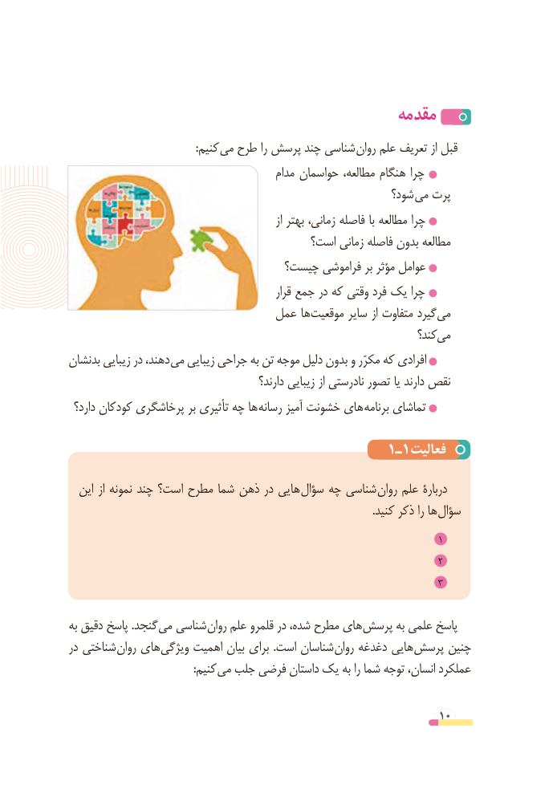

# PDF page 10

مقدمه
                                               :کنیم می طرح را پرسش چند شناسی روان علم تعریف از قبل
                                           مدام حواسمان مطالعه، هنگام چرا
                                                         شود؟ می پرت
                                                              از بهتر زمانی، فاصله با مطالعه چرا
                                      است؟ زمانی فاصله بدون مطالعه
                               چیست؟ فراموشی بر مؤثر عوامل
                                                     قرار جمع در که وقتی فرد یک چرا
                             عمل ها موقعیت سایر از متفاوت گیرد می
                                                                      کند؟ می
بدنشان زیبایی در دهند، می زیبایی جراحی به تن موجه دلیل بدون و مکرّر که افرادی
                                             دارند؟ زیبایی از نادرستی تصور یا دارند نقص
 دارد؟ کودکان پرخاشگری بر تأثیری چه ها رسانه آمیز خشونت های برنامه تماشای

                                      1ـ1فعالیت
  این از نمونه چند است؟ مطرح شما ذهن در هایی سؤال چه شناسی روان علم دربارۀ
         . کنید ذکر را ها سؤال
                                                                             1
                                                                             2
                                                                             3

به دقیق پاسخ .گنجد می شناسی روان علم قلمرو در شده، مطرح های پرسش به علمی پاسخ
در شناختی روان های ویژگی اهمیت بیان برای .است شناسان روان دغدغه هایی پرسش چنین
                                              :کنیم می جلب فرضی داستان یک به را شما توجه انسان، عملکرد

                                                          10

