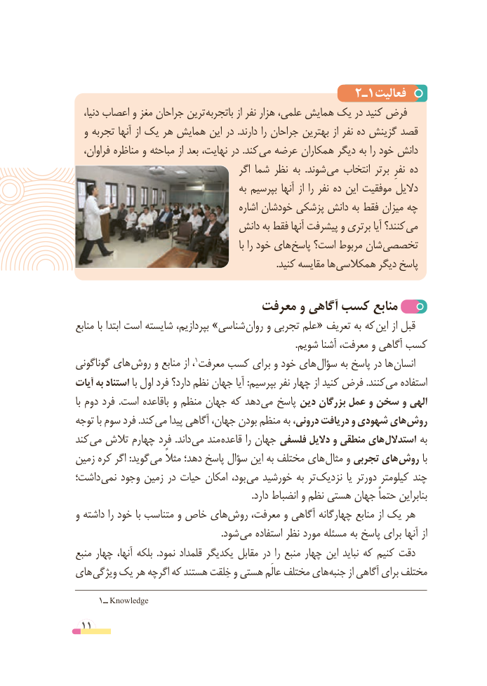

# PDF page 11

2ـ1فعالیت
   دنیا، اعصاب و مغز جراحان ترین باتجربه از نفر هزار علمی، همایش یک در کنید فرض
  و تجربه آنها از یک هر همایش این در .دارند را جراحان بهترین از نفر ده گزینش قصد
  فراوان، مناظره و مباحثه از بعد نهایت، در .کند می عرضه همکاران دیگر به را خود دانش
                                           اگر شما نظر به  .شوند می انتخاب برتر  نفرِ ده
                                          به بپرسیم آنها از را نفر ده این موفقیت دالیل
                                           اشاره خودشان پزشکی دانش به فقط میزان چه
                               دانش به فقط آنها پیشرفت و برتری آیا کنند؟ می
                                                              با را خود های پاسخ است؟ مربوط شان تخصصی
      . کنید مقایسه ها همکالسی دیگر پاسخ

                           معرفت و آگاهی کسب منابع
منابع با ابتدا است شایسته بپردازیم، »شناسی روان و تجربی علم« تعریف به که این از قبل
                                                                                            .شویم آشنا معرفت، و آگاهی کسب
گوناگونی های روش و منابع از ،1معرفت کسب برای و خود های سؤال به پاسخ در ها انسان
آیات به استناد با اول فرد دارد؟ نظم جهان آیا :بپرسیم نفر چهار از کنید فرض .کنندمی‌   استفاده
با دوم فرد  .است باقاعده و منظم جهان که دهد می پاسخ دین بزرگان عمل و سخن و الهی
توجه با سوم فرد .کند می پیدا آگاهی جهان، بودن منظم به درونی، دریافت و شهودی های روش
کند می تالش چهارم فرد .داند می مند قاعده را جهان فلسفی دالیل و منطقی های استدالل به
زمین کره اگر :گوید می مثالً دهد؛ پاسخ سؤال این به مختلف های مثال و تجربی های روش با
داشت؛ نمی وجود زمین در حیات امکان بود، می خورشید به تر نزدیک یا دورتر کیلومتر چند
                                                                          .دارد انضباط و نظم هستی جهان حتماً بنابراین
و داشته را خود با متناسب و خاص هایروش‌    معرفت، و آگاهی چهارگانه منابع از یک هر
              . شود می استفاده نظر مورد مسئله به پاسخ برای آنها از
منبع چهار آنها، بلکه  .نمود قلمداد یکدیگر مقابل در را منبع چهار این نباید که کنیم دقت
های ویژگی یک هر اگرچه که هستند خِلقت و هستی عالَم مختلف های‌جنبه از آگاهی برای مختلف

        ــ١ Knowledge
 11

