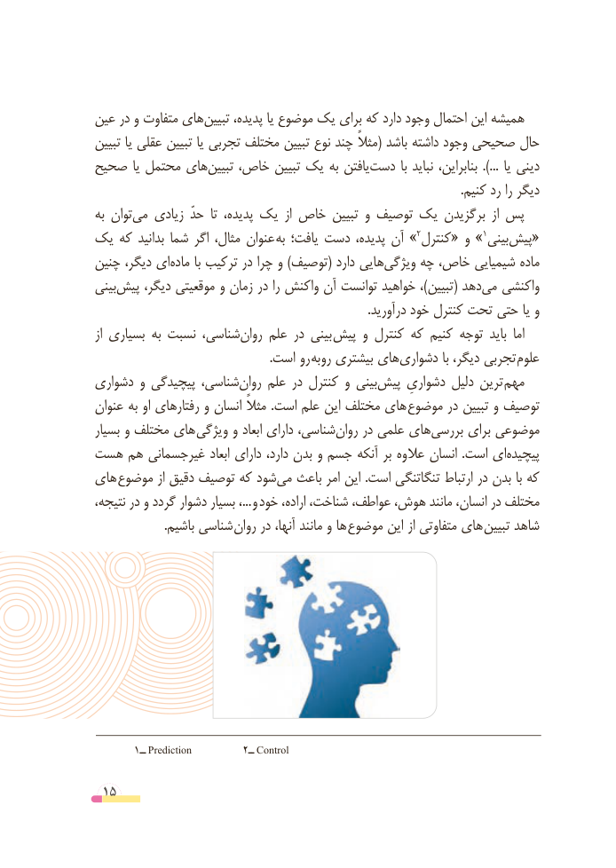

# PDF page 15

عین در و متفاوت هایتبیین‌     پدیده، یا موضوع یک برای که دارد وجود احتمال این همیشه
تبیین یا عقلی تبیین یا تجربی مختلف تبیین نوع چند مثالً( باشد داشته وجود صحیحی حال
صحیح یا محتمل هایتبیین‌   خاص، تبیین یک به یافتن ‌دست  با نباید بنابراین،  ...). یا دینی
                                                                                                                          .کنیم رد را دیگر
به توان‌می زیادی حدّ  تا پدیده، یک  از خاص تبیین و توصیف یک برگزیدن  از پس
یک که بدانید شما اگر مثال، عنوان  »به یافت؛ دست پدیده، آن 2»کنترل« و   1بینی‌«پیش
چنین دیگر، ای‌ماده با ترکیب در چرا و )توصیف( دارد هایی‌ویژگی چه خاص، شیمیایی ماده
بینی ‌پیش دیگر، موقعیتی و زمان در را واکنش آن توانست خواهید ،)تبیین( دهدمی‌   واکنشی
                                                                                          .درآورید خود کنترل تحت حتی یا و
از بسیاری به نسبت شناسی،‌روان علم در بینی پیش و کنترل که کنیم توجه باید  اما
                                                          .است رو روبه بیشتری های‌دشواری با دیگر، تجربی علوم
دشواری و پیچیدگی شناسی، ‌روان علم در کنترل و بینی‌پیش دشواریِ دلیل ترین  مهم
عنوان به او رفتارهای و انسان مثالً .است علم این مختلف های موضوع در تبیین و توصیف
بسیار و مختلف های  ویژگی و ابعاد دارای شناسی،روان‌    در علمی های ‌بررسی برای موضوعی
هست هم غیرجسمانی ابعاد دارای دارد، بدن و جسم آنکه بر عالوه انسان  .است ای‌پیچیده
های  موضوع از دقیق توصیف که شودمی‌  باعث امر این .است تنگاتنگی ارتباط در بدن با که
نتیجه، در و گردد دشوار بسیار ،... و خود اراده، شناخت، عواطف، هوش، مانند انسان، در مختلف
                       .باشیم شناسی روان در آنها، مانند و ها  موضوع این از متفاوتی های تبیین شاهد

       1ــ Prediction         2ــ Control

 15

