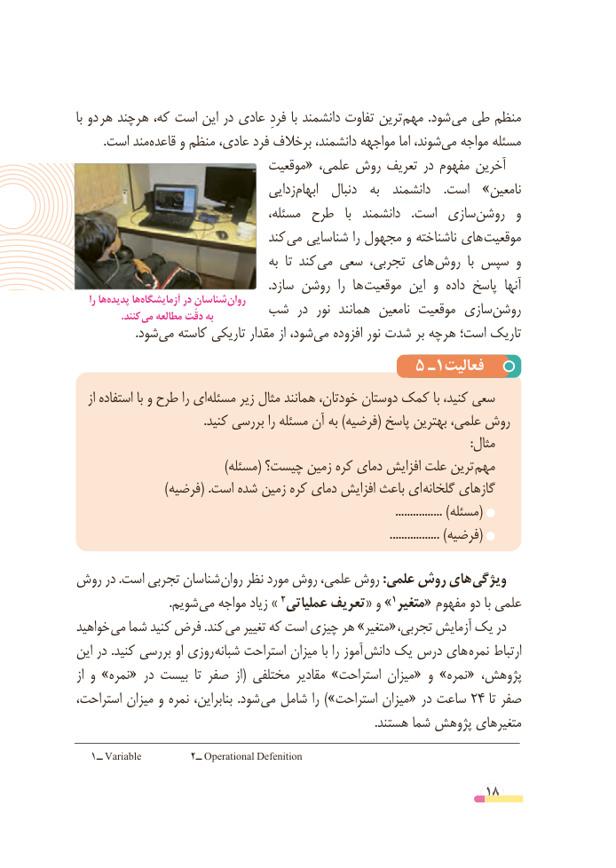

# PDF page 18

با دو هر هرچند که، است این در عادی فردِ با دانشمند تفاوت ترین مهم  .شود می طی منظم
 .‌است مندقاعده و منظم عادی، فرد برخالف دانشمند، مواجهه اما شوند،می‌   مواجه مسئله
                               موقعیت« علمی، روش تعریف در مفهوم آخرین
                                   زدایی ‌ابهام   دنبال   به  دانشمند    .است  »نامعین
                                    مسئله، طرح   با  دانشمند    .است  سازی‌روشن  و
                                 کند  می شناسایی را مجهول و ناشناخته های موقعیت
                                        به  تا کند می سعی تجربی، های  روش  با سپس و
                                                                .سازد روشن  را ها  موقعیت این و  داده پاسخ  آنها
    را هاپدیده‌     هاآزمایشگاه‌         در شناسان روان  شب  در  نور  همانند  نامعین موقعیت سازی‌روشن    . کنند می مطالعه دقّت به
    .‌شودمی کاسته تاریکی مقدار از شود،‌می افزوده نور شدت بر هرچه است؛ تاریک
                                     5 ـ1فعالیت
   از استفاده با و طرح را ایمسئله‌      زیر مثال همانند خودتان، دوستان کمک با کنید، سعی
                                          .کنید بررسی را مسئله آن به )فرضیه( پاسخ بهترین علمی، روش
                                                                                                                                   :مثال
 ) مسئله( چیست؟ زمین کره دمای افزایش علت ترین مهم
 ) فرضیه( .است شده زمین کره دمای افزایش باعث ای گلخانه گازهای
                                                                                                             ................ )مسئله(
                                                                                                           ................. )فرضیه(
روش در .است تجربی شناسان روان نظر مورد روش علمی، روش :علمی روش های ویژگی
      . شویم می مواجه زیاد » 2»عملیاتی تعریف« و                                                                1متغیر« مفهوم دو با علمی
خواهید می شما کنید فرض .کند  «می تغییر که است چیزی هر »متغیر   ،درتجربی آزمایش یک
این در .کنید بررسی او روزی  شبانه استراحت میزان با را آموز  دانش یک درس های نمره ارتباط
از و »نمره« در بیست  تا صفر  از( مختلفی مقادیر »استراحت میزان« و »نمره« پژوهش،
استراحت، میزان و نمره بنابراین،  .شود می شامل را »)استراحت میزان« در ساعت ٤٢   تا صفر
                                                                                                     .هستند شما پژوهش متغیرهای
   1ــ Variable         2ــ Operational Defenition

                                                          18

