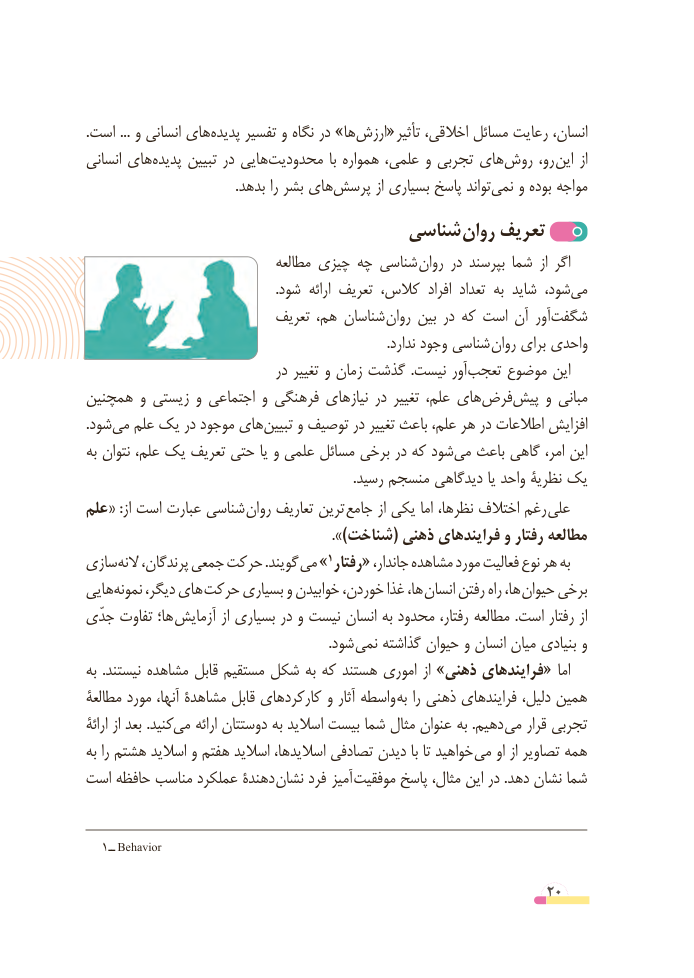

# PDF page 20

.است ... و انسانی های‌پدیده تفسیر و نگاه در »هاارزش‌« تأثیر اخالقی، مسائل رعایت انسان،
انسانی های‌پدیده تبیین در هایی ‌محدودیت  با همواره علمی، و تجربی های ‌روش رو، این از
   .‌بدهد را بشر های پرسش از بسیاری پاسخ تواند‌نمی و بوده مواجه
                               شناسی روان تعریف
                                مطالعه چیزی چه شناسی روان در بپرسند شما  از اگر
                                                         .شود  ارائه تعریف کالس،  افراد  تعداد به شاید شود، ‌می
                            تعریف هم، شناسان روان بین در که است آن آور‌شگفت
      . ندارد وجود شناسی روان برای واحدی
                                در تغییر و زمان گذشت  .نیست آور‌تعجب موضوع این
همچنین و زیستی و اجتماعی و فرهنگی نیازهای در تغییر علم، های‌فرض ‌پیش و مبانی
.شودمی‌  علم یک در موجود های ‌تبیین و توصیف در تغییر باعث علم، هر در اطالعات افزایش
به نتوان علم، یک تعریف حتی یا و علمی مسائل برخی در که شود‌می باعث گاهی امر، این
                                                                               .رسید منسجم دیدگاهی یا واحد نظریۀ یک
علم« :از است عبارت شناسی روان تعاریف ترین جامع از یکی اما نظرها، اختالف رغم علی
                                               )».شناخت( ذهنی فرایندهای و رفتار مطالعه
سازی‌النه پرندگان، جمعی حرکت .گویند »می                                           1 رفتار« جاندار، مشاهده مورد فعالیت نوع هر به
هایی‌نمونه دیگر، های حرکت بسیاری و خوابیدن خوردن، غذا ها، انسان رفتن راه ها،  حیوان برخی
جدّی تفاوت ها؛  آزمایش از بسیاری در و نیست انسان به محدود رفتار، مطالعه .است رفتار از
                                                                       .شود نمی گذاشته حیوان و انسان میان بنیادی و
به  .نیستند مشاهده قابل مستقیم شکل به که هستند اموری از »ذهنی فرایندهای « اما
مطالعۀ مورد آنها، مشاهدۀ قابل کارکردهای و آثار واسطه به را ذهنی فرایندهای دلیل، همین
ارائۀ از بعد .کنید می ارائه دوستتان به اسالید بیست شما مثال عنوان به .دهیم می قرار تجربی
به را هشتم اسالید و هفتم اسالید اسالیدها، تصادفی دیدن با تا خواهید می او از تصاویر همه
است حافظه مناسب عملکرد دهندۀ نشان فرد  آمیز موفقیت پاسخ مثال، این در .دهد نشان شما

   1ــ Behavior

                                                          20

