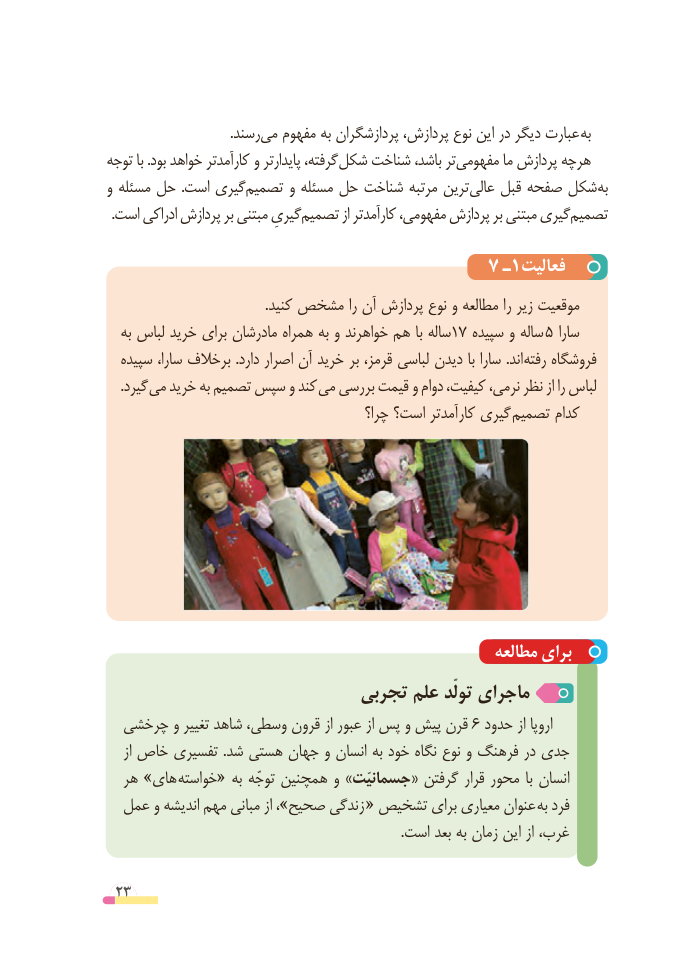

# PDF page 23

.رسندمی‌   مفهوم به پردازشگران پردازش، نوع این در دیگر عبارت به
توجه با .بود خواهد کارآمدتر و پایدارتر گرفته، شکل شناخت باشد، ترمفهومی‌        ما پردازش هرچه
و مسئله حل  .است گیریتصمیم‌      و مسئله حل شناخت مرتبه ترین عالی قبل صفحه شکل به
.‌است ادراکی پردازش بر مبتنی گیریِتصمیم از کارآمدتر مفهومی، پردازش بر مبتنی گیریتصمیم‌

                                     7 ـ1فعالیت
                                               .کنید مشخص را آن پردازش نوع و مطالعه را زیر موقعیت
   به لباس خرید برای مادرشان همراه به و خواهرند هم با ساله17 سپیده و ساله 5 سارا
  سپیده سارا، برخالف .دارد اصرار آن خرید بر قرمز، لباسی دیدن با سارا .اند رفته فروشگاه
 . گیرد می خرید به تصمیم سپس و کند می بررسی قیمت و دوام کیفیت، نرمی، نظر از را لباس
                                           چرا؟ است؟ کارآمدتر گیری تصمیم کدام

                                                      مطالعه برای
                           تجربی علم تولّد ماجرای
  چرخشی و تغییر شاهد وسطی، قرون از عبور از پس و پیش قرن 6 حدود از اروپا
    از خاص تفسیری .شد هستی جهان و انسان به خود نگاه نوع و فرهنگ در جدی
  هر »های خواسته« به توجّه همچنین و »جسمانیّت« گرفتن قرار محور  با انسان
  عمل و اندیشه مهم مبانی از ،»صحیح زندگی  « تشخیص برای معیاری عنوان  به فرد
                                                                                      .است بعد به زمان این از غرب،

 23

