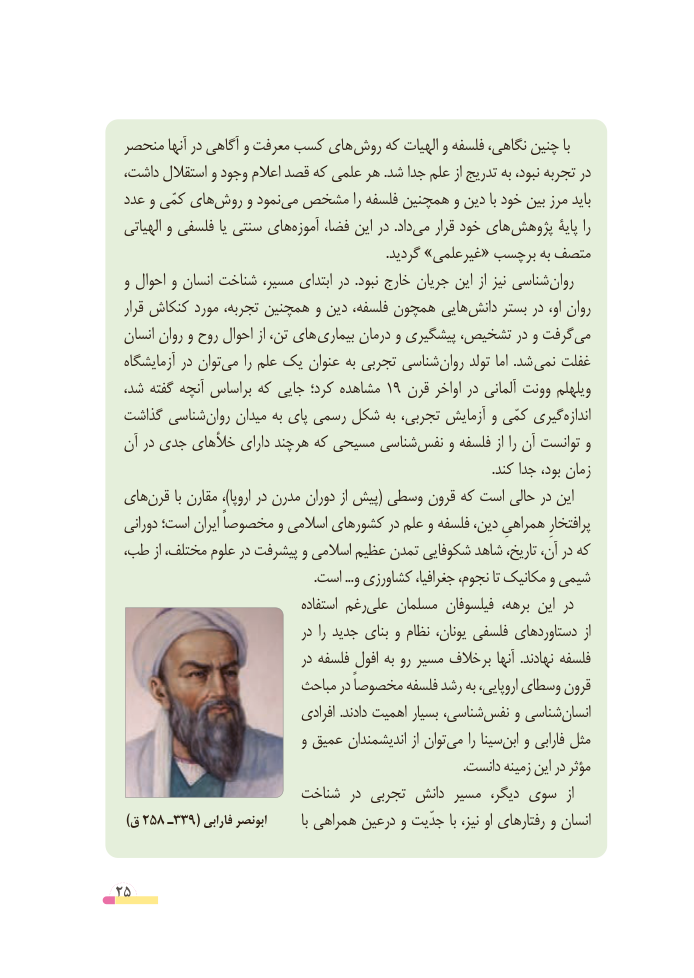

# PDF page 25

منحصر آنها در آگاهی و معرفت کسب های روش که الهیات و فلسفه نگاهی، چنین با
 داشت، استقالل و وجود اعالم قصد که علمی هر .شد جدا علم از تدریج به نبود، تجربه در
 عدد و کمّی هایروش‌    و نمودمی‌ مشخص‌           را فلسفه همچنین و دین با خود بین مرز باید
  الهیاتی و فلسفی یا سنتی هایآموزه‌    فضا، این در .دادمی‌    قرار خود های پژوهش پایۀ را
                                                                               .گردید »غیرعلمی« برچسب به متصف
 و احوال و انسان شناخت مسیر، ابتدای در  .نبود خارج جریان این از نیز شناسی ‌روان
  قرار کنکاش مورد تجربه، همچنین و دین فلسفه، همچون هایی‌دانش بستر در او، روان
 انسان روان و روح احوال از تن، های بیماری درمان و پیشگیری تشخیص، در و گرفت ‌می
 آزمایشگاه در توان ‌می را علم یک عنوان به تجربی شناسی ‌روان تولد اما  .شد  نمی غفلت
 شد، گفته آنچه براساس که جایی کرد؛ مشاهده 19 قرن اواخر در آلمانی وونت ویلهلم
 گذاشت شناسی ‌روان میدان به پای رسمی شکل به تجربی، آزمایش و کمّی گیریاندازه‌
 آن در جدی خألهای دارای هرچند که مسیحی شناسی‌نفس و فلسفه از را آن توانست و
                                                                                                                  .کند جدا بود، زمان
 هایقرن‌      با مقارن ،)اروپا در مدرن دوران از پیش( وسطی قرون که است حالی در این
 دورانی است؛ ایران مخصوصاً و اسالمی کشورهای در علم و فلسفه دین، همراهیِ پرافتخارِ
 طب، از مختلف، علوم در پیشرفت و اسالمی عظیم تمدن شکوفایی شاهد تاریخ، آن، در که
                                                           .است ...و کشاورزی جغرافیا، نجوم، تا مکانیک و شیمی
                                    استفاده رغمعلی‌    مسلمان فیلسوفان برهه، این در
                                 در  را جدید بنای و نظام یونان، فلسفی دستاوردهای  از
                                 در فلسفه افول به رو مسیر خالف بر آنها  .نهادند فلسفه
                          مباحث در مخصوصاً فلسفه رشد به اروپایی، وسطای قرون
                                 افرادی .دادند اهمیت بسیار شناسی،نفس‌    و شناسیانسان‌
                              و عمیق اندیشمندان از توانمی‌    را سیناابن‌   و فارابی مثل
                                                                                                         .دانست زمینه این در مؤثر
                        شناخت  در تجربی دانش مسیر  دیگر، سوی  از
   )ق 258 ـ339( فارابی ابونصر         با همراهی درعین و جدّیت با نیز، او رفتارهای و انسان

25

