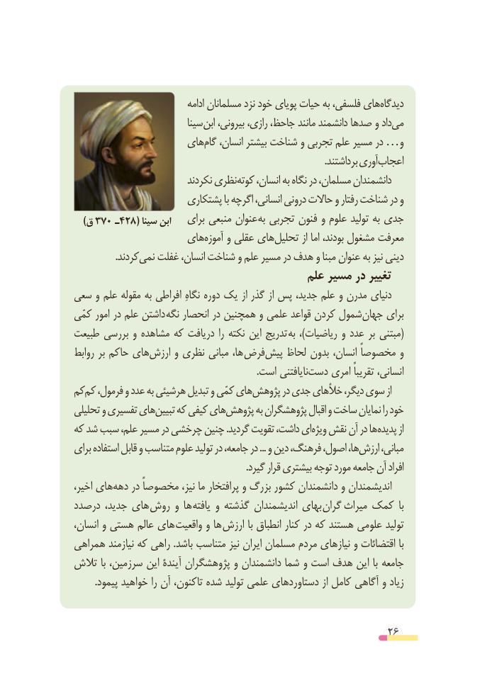

# PDF page 26

ادامه مسلمانان نزد خود پویای حیات به فلسفی، هایدیدگاه‌
                            سینا ابن بیرونی، رازی، جاحظ، مانند دانشمند صدها و دادمی‌
                    هایگام‌   انسان، بیشتر شناخت و تجربی علم مسیر در …و
                                                                                                         .برداشتند آوریاعجاب‌
                           نکردند نظریکوته‌    انسان، به نگاه در مسلمان، دانشمندان
                       پشتکاری با اگرچه انسانی، درونی حاالت و رفتار شناخت در و
   )ق 370  ـ428( سینا ابن    برای منبعی عنوان به تجربی فنون و علوم تولید به جدی
                    هایآموزه‌    و عقلی هایتحلیل‌        از اما بودند، مشغول معرفت
   .‌کردندنمی غفلت انسان، شناخت و علم مسیر در هدف و مبنا عنوان به نیز دینی
                                         علم مسیر در تغییر
سعی و علم مقوله به افراطی نگاهِ دوره یک از گذر از پس جدید، علم و مدرن دنیای
کمّی امور در علم داشتن نگه انحصار در همچنین و علمی قواعد کردن شمول ‌جهان برای
طبیعت بررسی و مشاهده که دریافت را نکته این تدریج (به  ،)ریاضیات و عدد بر مبتنی
روابط بر حاکم هایارزش‌     و نظری مبانی ها، فرض‌پیش لحاظ بدون انسان، مخصوصاً و
                                                                               .است نایافتنی‌دست امری تقریباً انسانی،
کمکم‌  فرمول، و عدد به هرشیئی تبدیل و کمّی هایپژوهش‌       در جدی خألهای دیگر، سوی از
تحلیلی و تفسیری هایتبیین‌    که کیفی هایپژوهش‌       به پژوهشگران اقبال و ساخت نمایان را خود
که شد سبب علم، مسیر در چرخشی چنین .گردید تقویت داشت، ای ویژه نقش آن در ها پدیده از
برای استفاده قابل و متناسب علوم تولید در جامعه، در ... و دین فرهنگ، اصول، ها،ارزش‌     مبانی،
                                                                        .گیرد قرار بیشتری توجه مورد جامعه آن‌   افراد
اخیر، هایدهه‌    در مخصوصاً نیز، ما پرافتخار و بزرگ کشور دانشمندان و اندیشمندان
درصدد جدید، های  روش و ها یافته و گذشته اندیشمندان بهای  گران   میراث کمک  با
انسان، و هستی عالم های واقعیت و ها ارزش با انطباق کنار در که هستند علومی تولید
همراهی نیازمند که راهی .باشد متناسب نیز ایران مسلمان مردم نیازهای و اقتضائات با
تالش با سرزمین، این آیندۀ پژوهشگران و دانشمندان شما و است هدف این با جامعه
         .پیمود خواهید را آن تاکنون، شده تولید علمی دستاوردهای از کامل آگاهی و زیاد

                                                        26

