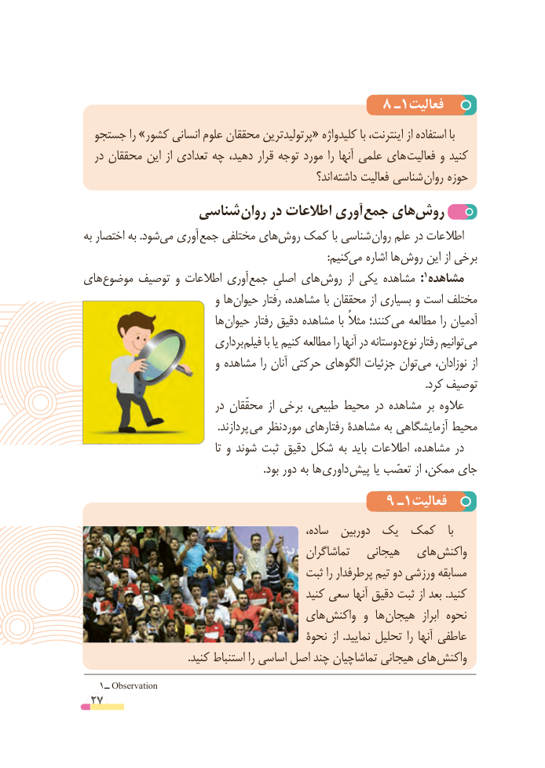

# PDF page 27

8 ـ1فعالیت
  جستجو را »کشور انسانی علوم محققان پرتولیدترین« کلیدواژه با اینترنت، از استفاده با
  در محققان این از تعدادی چه دهید، قرار توجه مورد را آنها علمی های  فعالیت و کنید
                                                            اند؟ داشته فعالیت شناسی روان حوزه
              شناسی روان در اطالعات آوری جمع هایروش‌
به اختصار به .شودمی‌  آوری جمع مختلفی هایروش‌   کمک با شناسی روان علم در اطالعات
                    :‌کنیممی اشاره ها روش این از برخی
های موضوع توصیف و اطالعات آوری جمع اصلیِ های :روش١مشاهدهاز یکی مشاهده
                           و ها حیوان رفتار مشاهده، با محققان از بسیاری و است مختلف
                            ها حیوان رفتار دقیق مشاهده با مثالً کنند؛ می مطالعه را آدمیان
                            برداری فیلم با یا کنیم مطالعه را آنها در دوستانه نوع رفتار توانیممی‌
                           و مشاهده را آنان حرکتی الگوهای جزئیات توانمی‌    نوزادان، از
                                                                                                                                   .کرد توصیف
                            در محقّقان  از برخی طبیعی، محیط در مشاهده بر عالوه
        . پردازند می موردنظر رفتارهای مشاهدۀ به آزمایشگاهی محیط
                                          تا و شوند ثبت دقیق شکل به باید اطالعات مشاهده، در
      . بود دور به ها داوری پیش یا تعصّب از ممکن، جای
                                     9 ـ1فعالیت
                                                 ساده،  دوربین یک کمک    با
                                              تماشاگران   هیجانی   های واکنش
                                      ثبت را پرطرفدار تیم دو ورزشی مسابقه
                                               کنید سعی آنها دقیق ثبت از بعد .کنید
                                  های واکنش و  ها هیجان  ابراز نحوه
                                          نحوة از  .نمایید تحلیل را آنها عاطفی
 . کنید استنباط را اساسی اصل چند تماشاچیان هیجانی های واکنش
   1ــ Observation
 27

