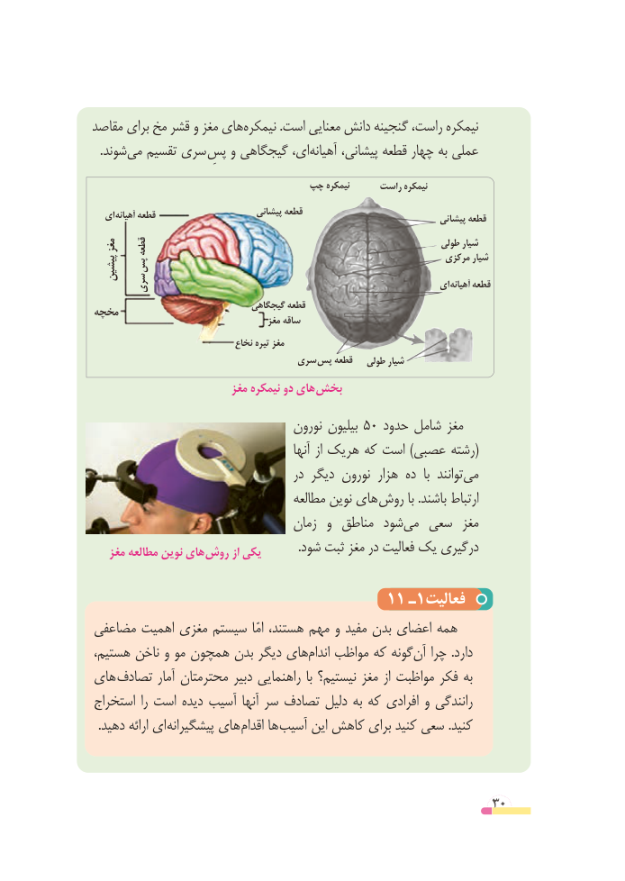

# PDF page 30

مقاصد برای مخ قشر و مغز هاینیمکره‌           .است معنایی دانش گنجینه راست، نیمکره
 .‌شوندمی تقسیم سری  پسِای،و گیجگاهی     آهیانه‌     پیشانی، قطعه چهار به عملی

                              چپ نیمکره      راست نیمکره
   ای آهیانه قطعه                       پیشانی قطعه                                                                                پیشانی قطعه
 مغز   قطعه                                                             طولی شیار
                                                                       مرکزی شیار
  پیشین  پس
   سری                                                           ای آهیانه قطعه
                                 گیجگاهی قطعهمخچه                                         مغز ساقه
                                نخاع تیره مغز
                                سری پس قطعه   طولی شیار
                          مغز نیمکره دو های بخش
                                   نورون بیلیون 50 حدود شامل مغز
                                               آنها از هریک که است )عصبی رشته(
                                      در دیگر نورون هزار ده  با  توانندمی‌
                                     مطالعه نوین های روش با .باشند ارتباط
                                  زمان  و مناطق شودمی‌   سعی  مغز
   مغز مطالعه نوین های روش از یکی            .شود ثبت مغز در فعالیت یک درگیری

                                11 ـ1فعالیت
مضاعفی اهمیت مغزی سیستم  امّا هستند، مهم و مفید بدن اعضای همه
هستیم، ناخن و مو همچون بدن دیگر هایاندام‌   مواظب که گونهآن‌  چرا .دارد
های تصادف آمار محترمتان دبیر راهنمایی با نیستیم؟ مغز از مواظبت فکر به
استخراج را است دیده آسیب آنها سر تصادف دلیل به که افرادی و رانندگی
. دهید ارائه ای پیشگیرانه های اقدام ها آسیب این کاهش برای کنید سعی .کنید

                                                        30

