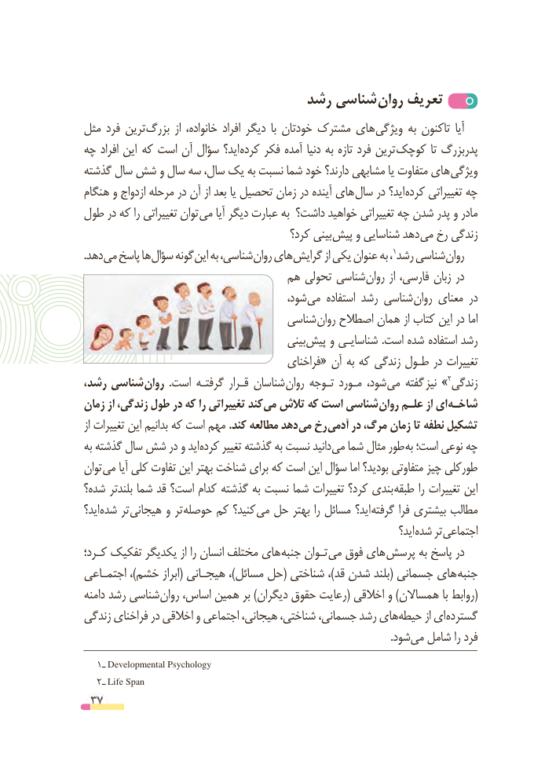

# PDF page 37

رشد شناسی روان تعریف
مثل فرد ترین بزرگ  از خانواده، افراد دیگر  با خودتان مشترک های ویژگی به تاکنون  آیا
چه افراد این  که است آن سؤال اید؟ کرده فکر آمده دنیا به تازه فرد ترین کوچک تا پدربزرگ
گذشته سال شش و سال سه سال، یک به نسبت شما خود دارند؟ مشابهی یا متفاوت های ویژگی
هنگام و ازدواج مرحله در آن از بعد یا تحصیل زمان در آینده های سال در اید؟ کرده تغییراتی چه
طول در که را تغییراتی توان می آیا دیگر عبارت به داشت؟ خواهید تغییراتی چه شدن پدر و مادر
                                         کرد؟ بینی پیش و شناسایی دهد می رخ زندگی
. دهد می پاسخ ها سؤال گونه این به شناسی، روان های گرایش از یکی عنوان به ، 1رشد شناسی روان
                               هم تحولی شناسی روان از فارسی، زبان در
                                         شود، می استفاده رشد شناسی روان معنای در
                                   شناسی روان اصطالح همان از کتاب این در اما
                                            بینی پیش و شناسایـی .است شده استفاده رشد
                                          فراخنای« آن به که زندگی طـول در تغییرات
، رشد شناسی روان  .است گرفتـه قـرار شناسان روان تـوجه مـورد شود، می گفته »نیز   2زندگی
زمان از زندگی، طول در که را تغییراتی کند می تالش که است شناسی روان علـم از ای شاخـه
از تغییرات این بدانیم که است مهم .کند مطالعه دهد می رخ آدمی در مرگ، زمان تا نطفه تشکیل
به گذشته سال شش در و اید کرده تغییر گذشته به نسبت دانید می شما مثال طور به است؛ نوعی چه
توان می آیا کلی تفاوت این بهتر شناخت برای که است این سؤال اما بودید؟ متفاوتی چیز طورکلی
شده؟ بلندتر شما قد است؟ کدام گذشته به نسبت شما تغییرات کرد؟ بندی طبقه را تغییرات این
اید؟ شده تر هیجانی و تر حوصله کم کنید؟ می حل بهتر را مسائل اید؟ گرفته فرا بیشتری مطالب
                                                                                 اید؟ شده تر اجتماعی
کـرد؛ تفکیک یکدیگر از را انسان مختلف های جنبه تـوان می فوق های پرسش به پاسخ در
اجتمـاعی ،)خشم ابراز( هیجـانی ،)مسائل حل( شناختی ،)قد شدن بلند( جسمانی های جنبه
دامنه رشد شناسی (روان اساس، همین بر )دیگران حقوق رعایت( اخالقی و )همساالن با روابط
زندگی فراخنای در اخالقی و اجتماعی هیجانی، شناختی، جسمانی، رشد هایحیطه‌       از ای گسترده
                                                                                                                   .شودمی‌  شامل را فرد
    1 ـ Developmental Psychology
    2 ـ Life Span
 37

