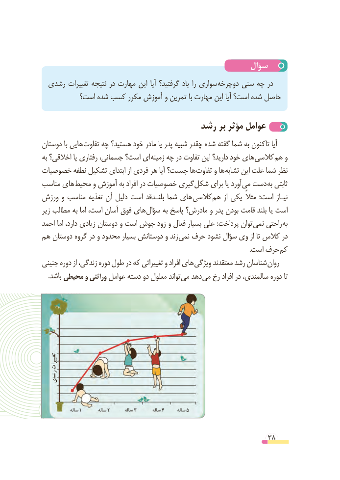

# PDF page 38

سؤال
 رشدی تغییرات نتیجه در مهارت این آیا گرفتید؟ یاد را سواری دوچرخه سنی چه در
          است؟ شده کسب مکرر آموزش و تمرین با مهارت این آیا است؟ شده حاصل

                               رشد بر مؤثر عوامل
دوستان با هایی تفاوت چه هستید؟ خود مادر یا پدر شبیه چقدر شده گفته شما به تاکنون آیا
به اخالقی؟ یا رفتاری جسمانی، است؟ ای زمینه چه در تفاوت این دارید؟ خود های کالسی هم و
خصوصیات نطفه تشکیل ابتدای از فردی هر آیا چیست؟ ها تفاوت و ها تشابه این علت شما نظر
مناسب های محیط و آموزش به افراد در خصوصیات گیری شکل برای یا آورد می دست به ثابتی
ورزش و مناسب تغذیه آن دلیل است بلنـدقد شما های کالسی هم از یکی مثالً است؛ نیـاز
زیر مطالب به اما است، آسان فوق های سؤال به پاسخ مادرش؟ و پدر بودن قامت بلند یا است
احمد اما دارد، زیادی دوستان و است جوش زود و فعال بسیار علی :پرداخت توان نمی راحتی به
هم دوستان گروه در و محدود بسیار دوستانش و زند نمی حرف نشود سؤال وی از تا کالس در
                                                                                                                             .است حرف کم
جنینی دوره از زندگی، دوره طول در که تغییراتی و افراد های ویژگی معتقدند رشد شناسان روان
    .باشد محیطی و وراثتی عوامل دسته دو معلول تواند می دهد می رخ افراد در سالمندی، دوره تا

    تغییرات
  رشدی

                                                          38

