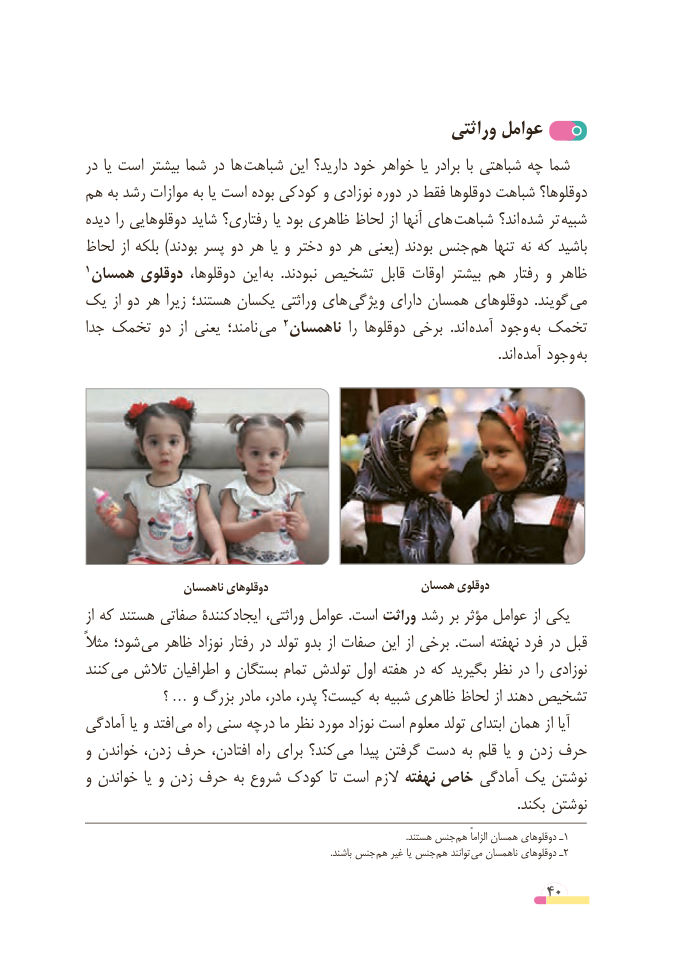

# PDF page 40

وراثتی عوامل
در یا است بیشتر شما در ها  شباهت این دارید؟ خود خواهر یا برادر  با شباهتی چه شما
هم به رشد موازات به یا است بوده کودکی و نوزادی دوره در فقط دوقلوها شباهت دوقلوها؟
دیده را دوقلوهایی شاید رفتاری؟ یا بود ظاهری لحاظ از آنها های  شباهت اند؟  شده تر  شبیه
لحاظ از بلکه ) بودند پسر دو هر یا و دختر دو هر یعنی ( بودند جنس  هم تنها نه که باشید
1 همسان دوقلوی دوقلوها، این  به  . نبودند تشخیص قابل اوقات بیشتر هم رفتار و ظاهر
یک از دو هر زیرا هستند؛ یکسان وراثتی های  ویژگی دارای همسان دوقلوهای  . گویند  می
جدا تخمک دو  از یعنی نامند؛  می                                     2 ناهمسان  را دوقلوها برخی  . اند  آمده وجود  به تخمک
                                                                                                                         . اند  آمده وجود  به

                 ناهمسان دوقلوهای                       همسان دوقلوی
از که هستند صفاتی کنندۀ ایجاد وراثتی، عوامل .است وراثت رشد بر مؤثر عوامل از یکی
مثالً شود؛ می ظاهر نوزاد رفتار در تولد بدو از صفات این از برخی  .است نهفته فرد در قبل
کنند  می تالش اطرافیان و بستگان تمام تولدش اول هفته در که بگیرید نظر در را نوزادی
               ؟…   و بزرگ مادر مادر، پدر، کیست؟ به شبیه ظاهری لحاظ از دهند تشخیص
آمادگی یا و افتد  می راه سنی درچه ما نظر مورد نوزاد است معلوم تولد ابتدای همان از آیا
و خواندن زدن، حرف افتادن، راه برای کند؟  می پیدا گرفتن دست به قلم یا و زدن حرف
و خواندن یا و زدن حرف به شروع کودک تا است الزم نهفته خاص آمادگی یک نوشتن
                                                                                                                               . بکند نوشتن
            . هستند جنس هم الزاماً همسان دوقلوهای ـ1
                                                                                                            .باشند جنس  هم غیر یا جنس هم توانند می ناهمسان دوقلوهای ـ2

                                                          40

