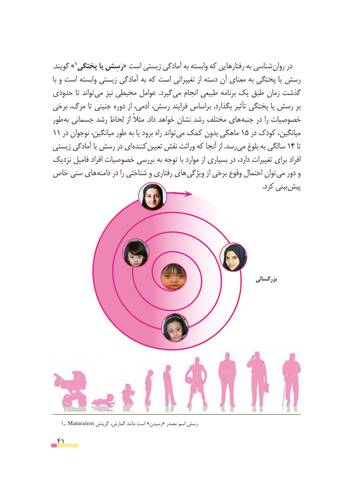

# PDF page 41

.»گویند        1پختگی یا رَسِش« است زیستی آمادگی به وابسته که رفتارهایی به شناسی روان در
با و است وابسته زیستی آمادگی به که است تغییراتی از دسته آن معنای به پختگی یا رسش
حدودی تا تواند می نیز محیطی عوامل  .گیرد می انجام طبیعی برنامه یک طبق زمان گذشت
برخی مرگ، تا جنینی دوره از آدمی، رسش، فرایند براساس .بگذارد تأثیر پختگی یا رسش بر
طور به جسمانی رشد لحاظ از مثالً .داد خواهد نشان رشد مختلف های جنبه در را خصوصیات
11 در نوجوان میانگین، طور به یا برود راه تواند می کمک بدون ماهگی 15 در کودک میانگین،
زیستی آمادگی یا رسش در ای کننده تعیین نقش وراثت که آنجا از .رسد می بلوغ به سالگی 14 تا
نزدیک فامیل افراد خصوصیات بررسی به توجه با موارد از بسیاری در دارد، تغییرات برای افراد
خاص سنی های دامنه در را شناختی و رفتاری های ویژگی از برخی وقوع احتمال توان می دور و
               . کرد بینی پیش

                                                                           بزرگسالی

    1 ـ Maturation گزینش گمارش، مانند است »رسیدن« مصدر اسم رسش

 41

