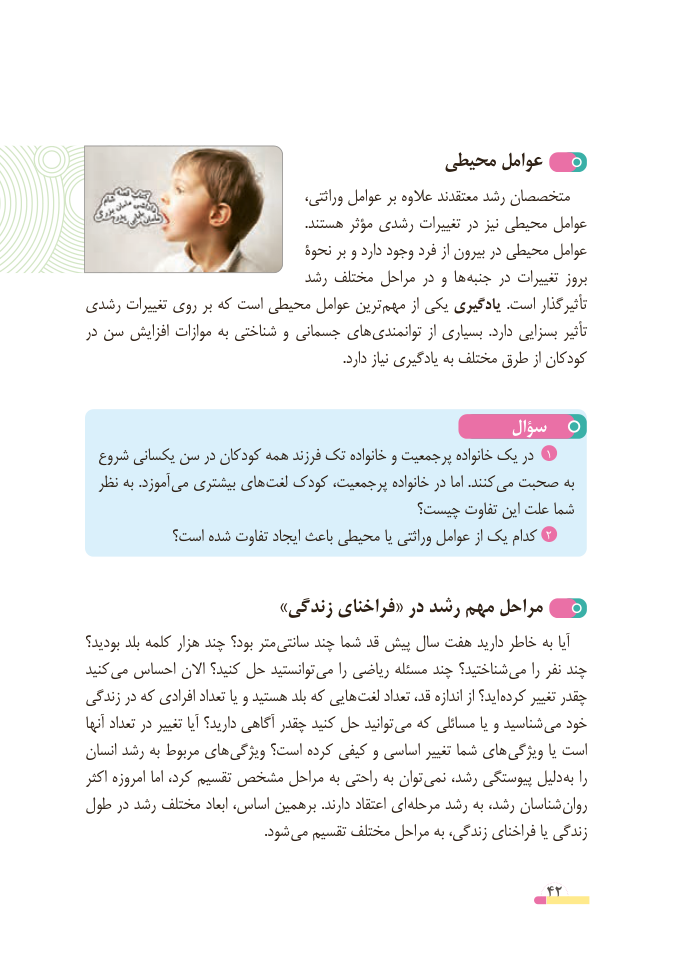

# PDF page 42

محیطی عوامل
       ،متخصصانوراثتی عوامل بر عالوه معتقدند رشد
                                                                .هستند مؤثر رشدی تغییرات در نیز محیطی عوامل
                                 نحوۀ بر و دارد وجود فرد از بیرون در محیطی عوامل
                             رشد مختلف مراحل در و ها جنبه در تغییرات بروز
رشدی تغییرات روی بر که است محیطی عوامل ترین مهم از یکی یادگیری .است تأثیرگذار
در سن افزایش موازات به شناختی و  جسمانی های توانمندی از بسیاری  .دارد بسزایی تأثیر
                                                                            .دارد نیاز یادگیری به مختلف طرق از کودکان

                                                سؤال
  شروع یکسانی سن در کودکان همه فرزند تک خانواده و پرجمعیت خانواده یک در  1
  نظر به .آموزد می بیشتری های لغت کودک پرجمعیت، خانواده در اما .کنند می صحبت به
                                      چیست؟ تفاوت این علت شما
           است؟ شده تفاوت ایجاد باعث محیطی یا وراثتی عوامل از یک کدام 2

                       »زندگی فراخنای« در رشد مهم مراحل
بودید؟ بلد کلمه هزار چند بود؟ متر سانتی چند شما قد پیش سال هفت دارید خاطر به آیا
کنید می احساس االن کنید؟ حل توانستید می را ریاضی مسئله چند شناختید؟ می را نفر چند
زندگی در که افرادی تعداد یا و هستید بلد که هایی لغت تعداد قد، اندازه از اید؟ کرده تغییر چقدر
آنها تعداد در تغییر آیا دارید؟ آگاهی چقدر کنید حل توانید می که مسائلی یا و شناسید می خود
انسان رشد به مربوط های ویژگی است؟ کرده کیفی و اساسی تغییر شما های ویژگی یا است
اکثر امروزه اما کرد، تقسیم مشخص مراحل به راحتی به توان نمی رشد، پیوستگی دلیل به را
طول در رشد مختلف ابعاد اساس، برهمین .دارند اعتقاد ای مرحله رشد به رشد، شناسان روان
            . شود می تقسیم مختلف مراحل به زندگی، فراخنای یا زندگی

                                                          42

