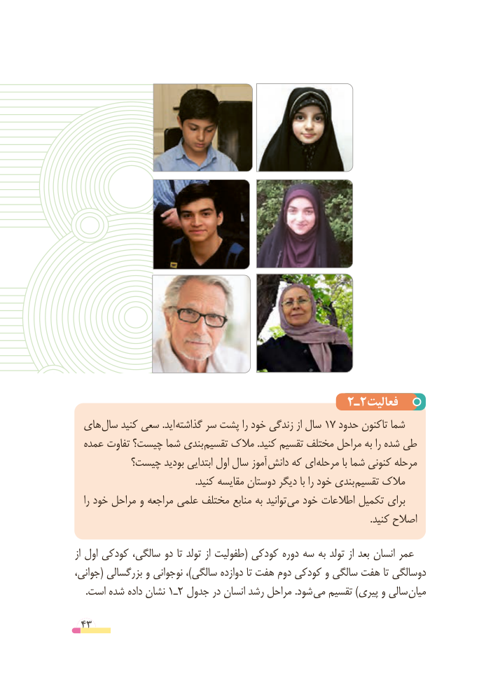

# PDF page 43

2ـ2فعالیت
  های سال کنید سعی .اید گذاشته سر پشت را خود زندگی از سال 17 حدود تاکنون شما
  عمده تفاوت چیست؟ شما بندی تقسیم مالک .کنید تقسیم مختلف مراحل به را شده طی
         چیست؟ بودید ابتدایی اول سال آموز دانش که ای مرحله با شما کنونی مرحله
 . کنید مقایسه دوستان دیگر با را خود بندی تقسیم مالک
   را خود مراحل و مراجعه علمی مختلف منابع به توانید می خود اطالعات تکمیل برای
                                                                                                                            .کنید اصالح
از اول کودکی سالگی، دو تا تولد از طفولیت( کودکی دوره سه به تولد از بعد انسان عمر
جوانی،( بزرگسالی و نوجوانی ،)سالگی دوازده تا هفت دوم کودکی و سالگی هفت تا دوسالگی
.1است شده داده نشان  ـ2 جدول در انسان رشد مراحل .شود می تقسیم )پیری و سالی میان

 43

