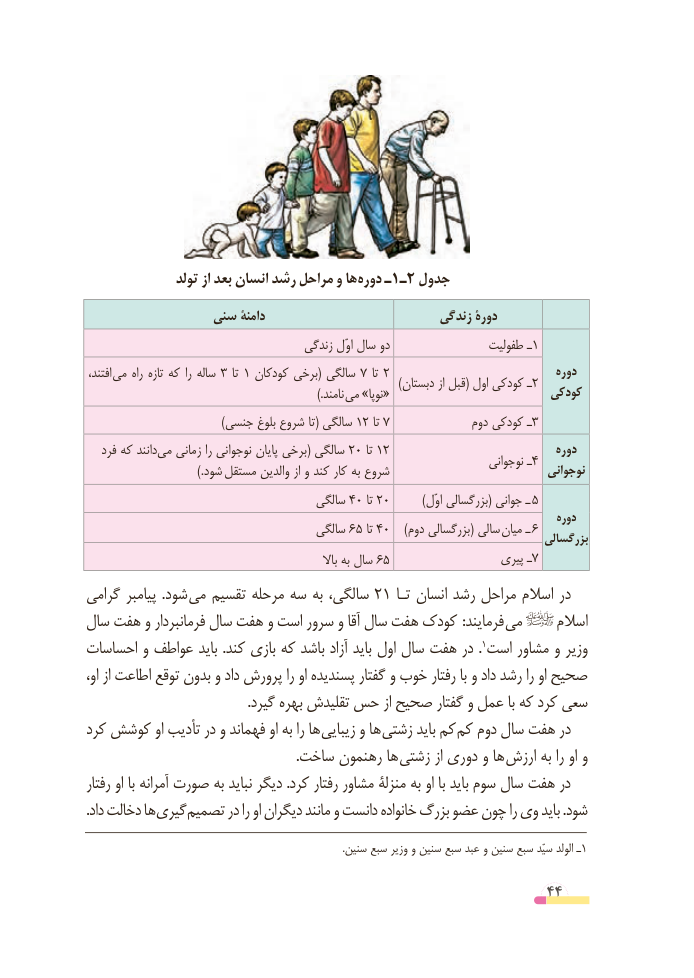

# PDF page 44

تولد از بعد انسان رشد مراحل و ها دوره ـ 1ـ2 جدول
                سنی دامنۀ                           زندگی دورۀ
                                      زندگى ل اوّ سال دو                 طفولیت ـ1
 ،افتند مى راه تازه که را ساله 3 تا 1 کودکان برخى( سالگى 7 تا 2                               دوره    )2دبستان از قبل( اول کودکى ـ                                                                          ).نامند «مى »نوپا                          کودکی
                                     )جنسی بلوغ شروع تا( سالگى 12 تا 7               دوم کودکى ـ3
   فرد که مىدانند زمانى را نوجوانى پایان برخى( سالگى 20 تا 12                               دوره                                                                                نوجوانى ـ4                                  ).شود  مستقل والدین از و کند کار به شروع                             نوجوانی
                                       سالگى 40 تا 20 ) 5ل اوّ بزرگسالى( جوانى ـ
                                                                                             دوره                                       سالگى 65 تا 40    )دوم بزرگسالى( سالى میان ـ 6                                                                                   بزرگسالی
                                                                باال به سال 65                   پیرى ـ7
گرامی پیامبر  .شود می تقسیم مرحله سه به سالگی، 21 تـا انسان رشد مراحل اسالم در
سال هفت و فرمانبردار سال هفت و است سرور و آقا سال هفت کودک  :فرمایند می        اسالم
احساسات و عواطف باید .کند بازی که باشد آزاد باید اول سال هفت در .1است مشاور و وزیر
او، از اطاعت توقع بدون و داد پرورش را او پسندیده گفتار و خوب رفتار با و داد رشد را او صحیح
                                               .گیرد بهره تقلیدش حس از صحیح گفتار و عمل با که کرد سعی
کرد کوشش او تأدیب در و فهماند او به را ها زیبایی و ها زشتی باید کم کم دوم سال هفت در
    . ساخت رهنمون ها زشتی از دوری و ها ارزش به را او و
رفتار او با آمرانه صورت به نباید دیگر .کرد رفتار مشاور منزلۀ به او با باید سوم سال هفت در
. داد دخالت ها گیری تصمیم در را او دیگران مانند و دانست خانواده بزرگ عضو چون را وی باید .شود
                                                                                                      .سنین سبع وزیر و سنین سبع عبد و سنین سبع سیّد الولد ـ1

                                                          44

