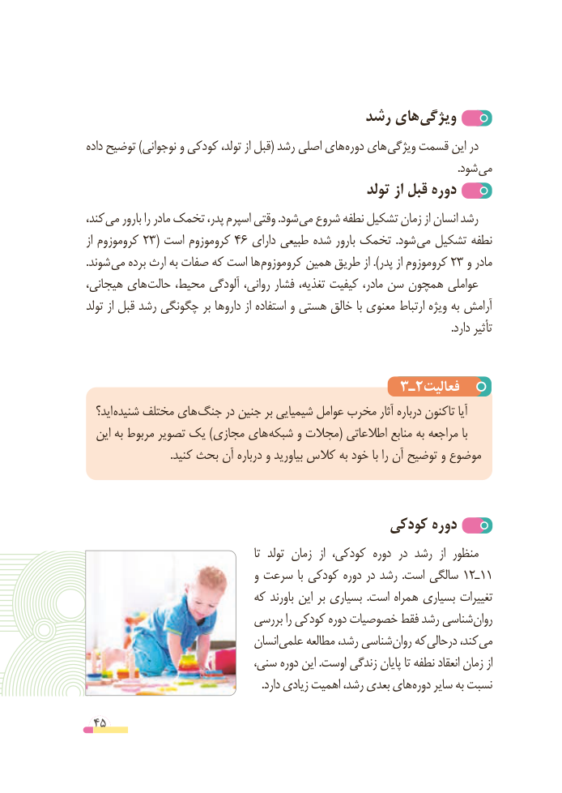

# PDF page 45

رشد های ویژگی
داده توضیح )نوجوانی و کودکی تولد، از قبل( رشد اصلی های دوره های ویژگی قسمت این در
                               . شود می
                                                تولد از قبل دوره
،کند می بارور را مادر تخمک پدر، اسپرم وقتی .شود می شروع نطفه تشکیل زمان از انسان رشد
از کروموزوم 23( است کروموزوم 46 دارای طبیعی شده بارور تخمک  .شود می تشکیل نطفه
.شوند می برده ارث به صفات که است ها کروموزوم همین طریق از ).پدر از کروموزوم 23 و مادر
هیجانی، های حالت محیط، آلودگی روانی، فشار تغذیه، کیفیت مادر، سن همچون عواملی
تولد از قبل رشد چگونگی بر داروها از استفاده و هستی خالق با معنوی ارتباط ویژه به آرامش
                                                                                                                                    .دارد تأثیر

                                     3ـ2فعالیت
  اید؟ شنیده مختلف های جنگ در جنین بر شیمیایی عوامل مخرب آثار درباره تاکنون آیا
  این به مربوط تصویر یک )مجازی های شبکه و مجالت( اطالعاتی منابع به مراجعه با
                               .کنید بحث آن درباره و بیاورید کالس به خود با را آن توضیح و موضوع

                                        کودکی دوره
                                                   تا  تولد زمان  از کودکی، دوره در رشد  از منظور
                                 و سرعت با کودکی دوره در رشد  .است سالگی 12ـ11
                            که باورند این بر بسیاری  .است همراه بسیاری تغییرات
                             بررسی را کودکی دوره خصوصیات فقط رشد شناسی روان
                                  انسان علمی مطالعه رشد، شناسی روان که درحالی کند، می
                             سنی، دوره این .اوست زندگی پایان تا نطفه انعقاد زمان از
                                                                .دارد زیادی اهمیت رشد، بعدی های دوره سایر به نسبت

 45

