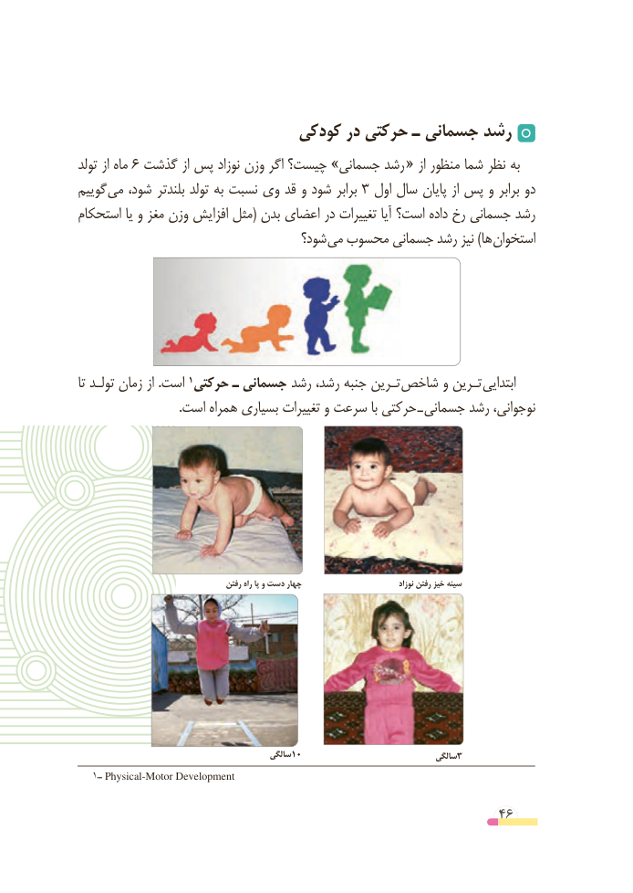

# PDF page 46

کودکی در حرکتی ـ جسمانی رشد
تولد از ماه 6 گذشت از پس نوزاد وزن اگر چیست؟ »جسمانی رشد « از منظور شما نظر به
گوییم می شود،  بلندتر تولد به نسبت وی قد و شود برابر 3 اول سال پایان از پس و برابر دو
استحکام یا و مغز وزن افزایش مثل( بدن اعضای در تغییرات آیا است؟ داده رخ جسمانی رشد
                                   شود؟ می محسوب جسمانی رشد نیز )ها استخوان

تا تولـد زمان از .است                       1حرکتی ـ جسمانی رشد رشد، جنبه تـرین­ شاخص و تـرین ابتدایی
 . است همراه بسیاری تغییرات و سرعت با حرکتی ـ جسمانی رشد نوجوانی،

                                       رفتن راه پا و دست چهار                                 نوزاد رفتن خیز سینه

                                            سالگی10                               سالگی3
  1ــ Physical-Motor Development

                                                          46

