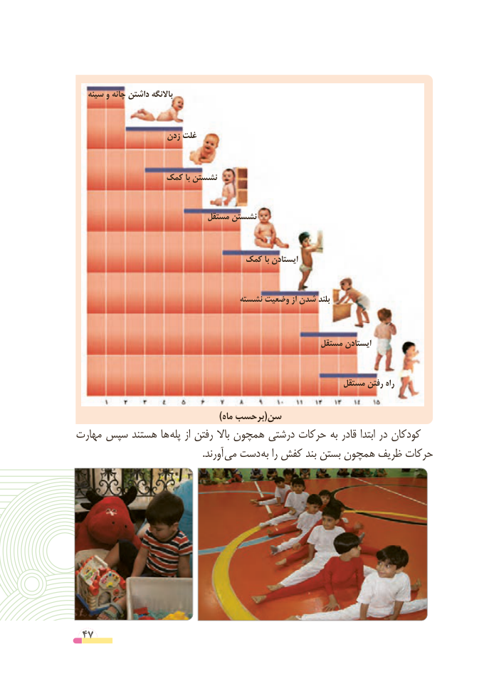

# PDF page 47

سینه و چانه داشتن باالنگه

                    زدن غلت

                کمک با نشستن

                              مستقل نشستن

                               کمک با ایستادن

                                    نشسته وضعیت از شدن بلند

                                                        مستقل ایستادن

                                                             مستقل رفتن راه

                                              )ماه برحسب(سن
مهارت سپس هستند ها پله از رفتن باال همچون درشتی حرکات به قادر ابتدا در کودکان
          . آورند می دست به را کفش بند بستن همچون ظریف حرکات

 47

