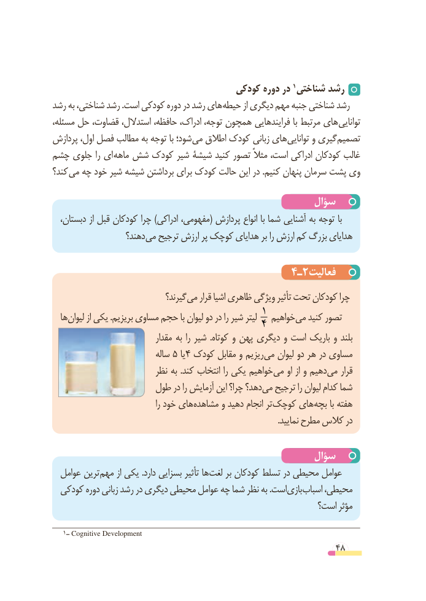

# PDF page 48

کودکی دوره در 1 شناختی رشد
رشد به شناختی، رشد .است کودکی دوره در رشد های حیطه از دیگری مهم جنبه شناختی رشد
مسئله، حل­   قضاوت، استدالل، حافظه، ادراک، توجه، همچون فرایندهایی با مرتبط های توانایی
پردازش اول، فصل مطالب به توجه با شود؛ ­می اطالق کودک زبانی های­ توانایی و گیری تصمیم
چشم جلوی را ای ماهه شش کودک شیر شیشۀ کنید تصور مثالً است، ادراکی کودکان غالب
کند؟ می چه خود شیر شیشه برداشتن برای کودک حالت این در .کنیم پنهان سرمان پشت وی

                                                سؤال
  دبستان، از قبل کودکان چرا )ادراکی مفهومی،( پردازش انواع با شما آشنایی به توجه با
                   دهند؟ می ترجیح ارزش پر کوچک هدایای بر را ارزش کم بزرگ هدایای

                                      4ـ2فعالیت
                                گیرند؟ می قرار اشیا ظاهری ویژگی تأثیر تحت کودکان چرا
  ها لیوان از یکی .بریزیم مساوی حجم با لیوان دو در را شیر لیتر 1 خواهیم می کنید تصور                                   4
                               مقدار به را شیر  .کوتاه و پهن دیگری و است باریک و بلند
                             ساله 5 یا 4 کودک مقابل و ریزیم می لیوان دو هر در مساوی
                         نظر به .کند انتخاب را یکی خواهیم می او از و دهیم می قرار
                   طول در را آزمایش این چرا؟ دهد؟ می ترجیح را لیوان کدام شما
                                          را خود های مشاهده و دهید انجام تر کوچک های بچه با هفته
                                                                                                            .نمایید مطرح کالس در

                                                سؤال
  عوامل ترین مهم از یکی .دارد بسزایی تأثیر ها لغت بر کودکان تسلط در محیطی عوامل
  کودکی دوره زبانی رشد در دیگری محیطی عوامل چه شما نظر به .است بازی اسباب محیطی،
                                                        است؟ مؤثر

   1ــ Cognitive Development
                                                          48

