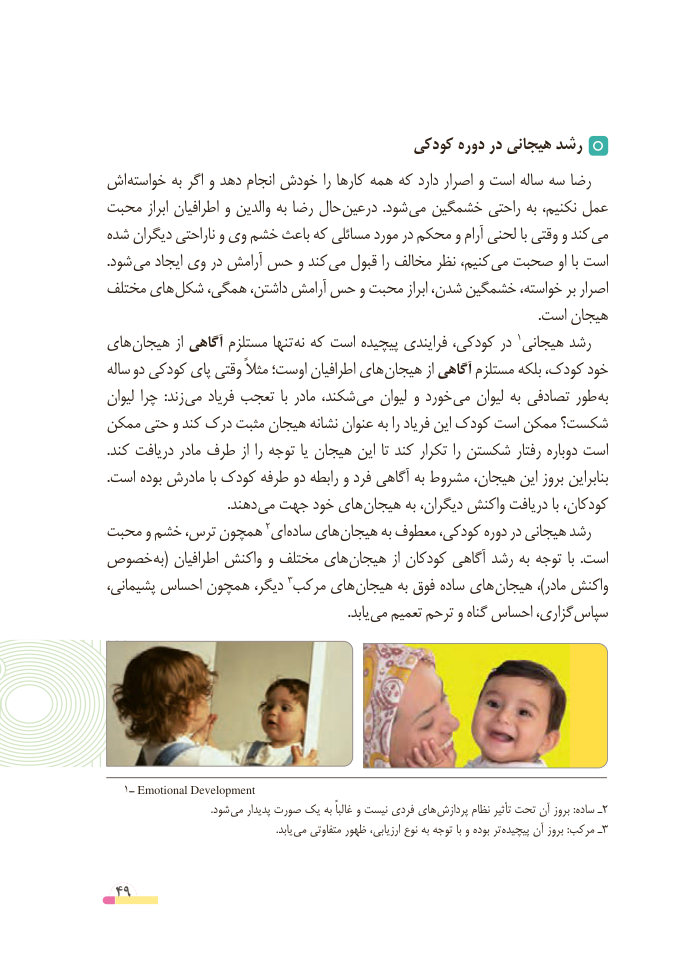

# PDF page 49

کودکی دوره در هیجانی رشد
اش خواسته به اگر و دهد انجام خودش را کارها همه که دارد اصرار و است ساله سه رضا
محبت ابراز اطرافیان و والدین به رضا حال درعین  .شود می خشمگین راحتی به نکنیم، عمل
شده دیگران ناراحتی و وی خشم باعث که مسائلی مورد در محکم و آرام لحنی با وقتی و کند می
.شود می ایجاد وی در آرامش حس و کند می قبول را مخالف نظر کنیم، می صحبت او با است
مختلف های شکل همگی، داشتن، آرامش حس و محبت ابراز شدن، خشمگین خواسته، بر اصرار
                                                                                                                               .است هیجان
های هیجان از آگاهی مستلزم تنها­ نه که است پیچیده فرایندی کودکی، در 1هیجانی رشد
ساله دو کودکی پای وقتی مثالً اوست؛ اطرافیان های هیجان از آگاهی مستلزم بلکه کودک، خود
لیوان چرا  :زند می فریاد تعجب  با مادر شکند، می لیوان و خورد می لیوان به تصادفی طور به
ممکن حتی و کند درک مثبت هیجان نشانه عنوان به را فریاد این کودک است ممکن شکست؟
.کند دریافت مادر طرف از را توجه یا هیجان این تا کند تکرار را شکستن رفتار دوباره است
.است بوده مادرش با کودک طرفه دو رابطه و فرد آگاهی به مشروط هیجان، این بروز بنابراین
       . دهند می جهت خود های هیجان به دیگران، واکنش دریافت با کودکان،
محبت و خشم ترس، همچون 2ای ساده های هیجان به معطوف کودکی، دوره در هیجانی رشد
خصوص به( اطرافیان واکنش و مختلف های هیجان از کودکان آگاهی رشد به توجه با  .است
پشیمانی، احساس همچون دیگر، 3مرکب های هیجان به فوق ساده های هیجان ،)مادر واکنش
                  . یابد می تعمیم ترحم و گناه احساس گزاری، سپاس

   1ــ Emotional Development
                                         .شود می پدیدار صورت یک به غالباً و نیست فردی های  پردازش نظام تأثیر تحت آن بروز :ساده ـ2
                                                                   .یابد می متفاوتی ظهور ارزیابی، نوع به توجه با و بوده تر  پیچیده آن بروز :مرکب ـ3

 49

