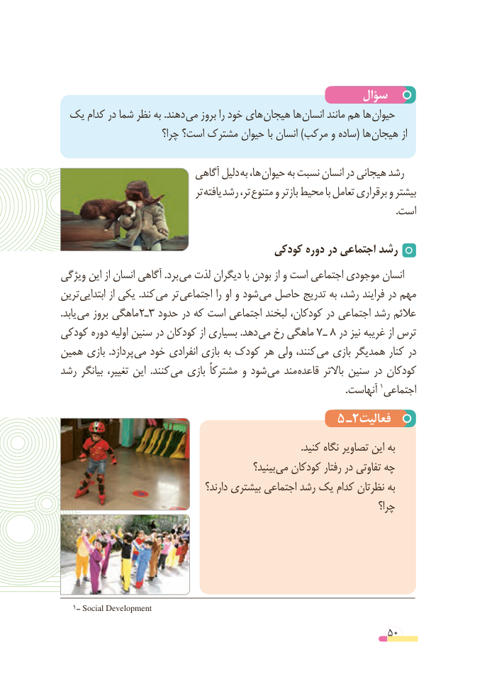

# PDF page 50

سؤال
 یک کدام در شما نظر به .دهند می بروز را خود های هیجان ها انسان مانند هم ها حیوان
                        چرا؟ است؟ مشترک حیوان با انسان )مرکب و ساده( ها هیجان از

                            آگاهی دلیل به ها، حیوان به نسبت انسان در هیجانی رشد
                                   تر یافته  رشد  ،تر متنوع و بازتر محیط با تعامل برقراری و بیشتر
                                                                                                                                           .است

                                     کودکی دوره در اجتماعی رشد
ویژگی این از انسان آگاهی .برد می لذت دیگران با بودن از و است اجتماعی موجودی انسان
ترین ابتدایی از یکی .کند می تر اجتماعی را او و شود می حاصل تدریج به رشد، فرایند در مهم
.یابد می بروز ماهگی 2ـ3 حدود در که است اجتماعی لبخند کودکان، در اجتماعی رشد عالئم
کودکی دوره اولیه سنین در کودکان از بسیاری .دهد می رخ ماهگی 7 ـ 8 در نیز غریبه از ترس
همین بازی  .پردازد می خود انفرادی بازی به کودک هر ولی کنند، می بازی همدیگر کنار در
رشد بیانگر تغییر، این  .کنند می بازی مشترکاً و شود می مند قاعده باالتر سنین در کودکان
                                                                                                                      .آنهاست 1اجتماعی
                                                                                         5 ـ2فعالیت
                                                                                                    .کنید نگاه تصاویر این به
                                                    بینید؟ می کودکان رفتار در تفاوتی چه
                                       دارند؟ بیشتری اجتماعی رشد یک کدام نظرتان به
                                                                           چرا؟

   1ــ Social Development

                                                          50

