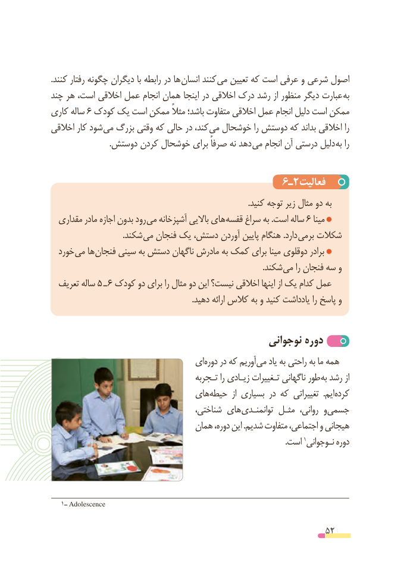

# PDF page 52

.کنند رفتار چگونه دیگران با رابطه در ها ­انسان کنند ­می تعیین که است عرفی و شرعی اصول
چند هر است، اخالقی عمل انجام همان اینجا در اخالقی درک رشد از منظور دیگر عبارت به
کاری ساله 6 کودک یک است ممکن مثالً باشد؛ متفاوت اخالقی عمل انجام دلیل است ممکن
اخالقی کار شود می بزرگ وقتی که حالی در کند، می خوشحال را دوستش که بداند اخالقی را
 . دوستش کردن خوشحال برای صرفاً نه دهد می انجام آن درستی دلیل به را

                                      6ـ2فعالیت
                                                                                                 .کنید توجه زیر مثال دو به
  مقداری مادر اجازه بدون رود می آشپزخانه باالیی های قفسه سراغ به .است ساله 6 مینا
                                    .شکند می فنجان یک دستش، آوردن پایین هنگام .دارد برمی شکالت
  خورد می ها فنجان سینی به دستش ناگهان مادرش به کمک برای مینا دوقلوی برادر
                                                                                                         .شکند می را فنجان سه و
  تعریف ساله 5 ـ 6 کودک دو برای را مثال دو این نیست؟ اخالقی اینها از یک کدام عمل
                                                                      .دهید ارائه کالس به و کنید یادداشت را پاسخ و

                                              نوجوانی دوره
                                ای دوره در که آوریم می یاد به راحتی به ما همه
                                      تـجربه را زیـادی تـغییرات ناگهانی طور به رشد از
                              های حیطه  از بسیاری در که تغییراتی  .ایم کرده
                                      شناختی، های توانمنـدی مثـل  روانی، و جسمی
                                 همان دوره، این .شدیم متفاوت اجتماعی، و هیجانی
                      .1است نـوجوانی دوره

   1ــ Adolescence

                                                          52

