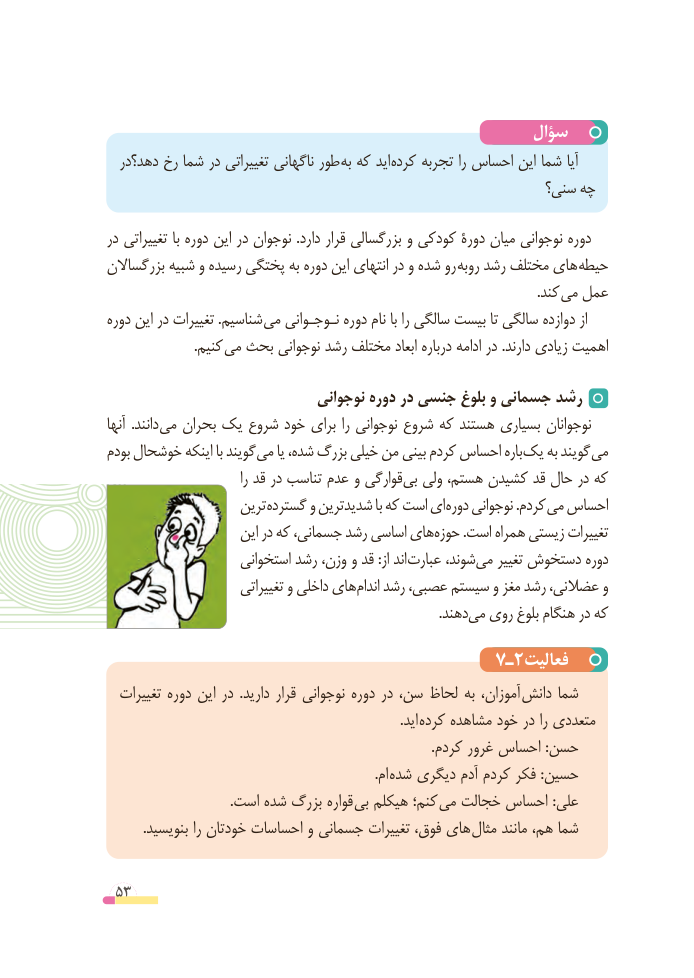

# PDF page 53

سؤال
  دهد؟در رخ شما در تغییراتی ناگهانی طور به که اید کرده تجربه را احساس این شما آیا
                                                        سنی؟ چه
در تغییراتی با دوره این در نوجوان .دارد قرار بزرگسالی و کودکی دورۀ میان نوجوانی دوره
بزرگساالن شبیه و رسیده پختگی به دوره این انتهای در و شده رو روبه رشد مختلف های حیطه
                                                                                                                              .کند می عمل
دوره این در تغییرات .شناسیم می نـوجـوانی دوره نام با را سالگی بیست تا سالگی دوازده از
     . کنیم می بحث نوجوانی رشد مختلف ابعاد درباره ادامه در .دارند زیادی اهمیت

                               نوجوانی دوره در جنسی بلوغ و جسمانی رشد
آنها  .دانند می بحران یک شروع خود برای را نوجوانی شروع که هستند بسیاری نوجوانان
بودم خوشحال اینکه با گویند می یا شده، بزرگ خیلی من  بینی کردم احساس باره یک به گویند می
                                 را قد در تناسب عدم و قوارگی بی ولی هستم، کشیدن قد حال در که
                    ترین ­گسترده و شدیدترین با که است ای­ دوره نوجوانی .کردم می احساس
                      این در که جسمانی، رشد اساسی هایحوزه‌       .است همراه زیستی تغییرات
                     استخوانی رشد وزن، و قد :از اند عبارت شوند،می‌   تغییر دستخوش دوره
                        تغییراتی و داخلی های اندام رشد عصبی، سیستم و مغز رشد عضالنی، و
                                                                                                  .دهندمی‌  روی بلوغ هنگام در که

                                      7ـ2فعالیت
  تغییرات دوره این در  .دارید قرار نوجوانی دوره در سن، لحاظ به آموزان، دانش شما
                          . اید کرده مشاهده خود در را متعددی
                                                                                               .کردم غرور احساس :حسن
                             . ام شده دیگری آدم کردم فکر :حسین
  . است شده بزرگ قواره بی هیکلم کنم؛ می خجالت احساس :علی
. بنویسید را خودتان احساسات و جسمانی تغییرات فوق، های مثال مانند هم، شما

 53

