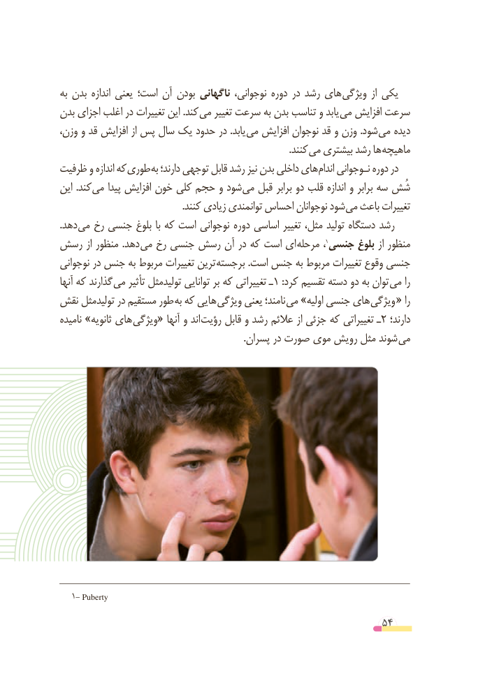

# PDF page 54

به بدن اندازه یعنی است؛ آن بودن ناگهانی نوجوانی، دوره در رشد های ویژگی  از یکی
بدن اجزای اغلب در تغییرات این .کند می تغییر سرعت به بدن تناسب و یابد می افزایش سرعت
وزن، و قد افزایش از پس سال یک حدود در .یابد می افزایش نوجوان قد و وزن .شود می دیده
                                                                                                .کنند می بیشتری رشد ها ماهیچه
ظرفیت و اندازه که طوری به دارند؛ توجهی قابل رشد نیز بدن داخلی های اندام نـوجوانی دوره در
این .کند می پیدا افزایش خون کلی حجم و شود می قبل برابر دو قلب اندازه و برابر سه شُش
 . کنند زیادی توانمندی احساس نوجوانان شود می باعث تغییرات
.دهد می رخ جنسی بلوغ با که است نوجوانی دوره اساسی تغییر مثل، تولید دستگاه رشد
رسش از منظور  .دهد می رخ جنسی رسش آن در که است ای­ مرحله ،                                                                                               1جنسی بلوغ از منظور
نوجوانی در جنس به مربوط تغییرات ترین ­برجسته .است جنس به مربوط تغییرات وقوع جنسی
آنها که گذارند ­می تأثیر تولیدمثل توانایی بر که تغییراتی ـ1 :کرد تقسیم دسته دو به توان می را
نقش تولیدمثل در مستقیم طور به که هایی­ ویژگی یعنی نامند؛ می »اولیه جنسی های ­ویژگی « را
نامیده »ثانویه های ­ویژگی« آنها و اند رؤیت قابل و رشد عالئم از جزئی که تغییراتی ـ 2 دارند؛
  . پسران در صورت موی رویش مثل شوند می

   1- Puberty

                                                          54

