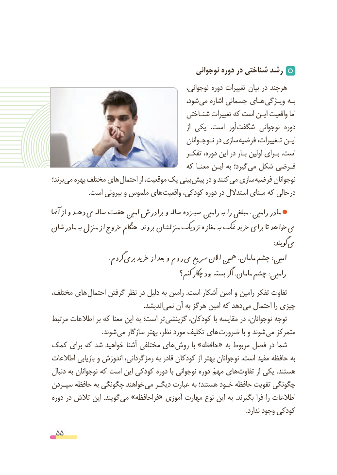

# PDF page 55

نوجوانی دوره در شناختی رشد
        ،هرچندنوجوانی دوره تغییرات بیان در
                                           شود، می اشاره جسمانی هـای ویـژگی بـه
                                        شنـاختی تغییرات که است ایـن واقعیت اما
                                                                   از یکی   .است  آور شگفت نوجوانی دوره
                                                نـوجـوانان در سازی فرضیه تـغییرات، ایـن
                                            تفکـر دوره، این در بـار اولین بـرای .است
                                     که معنـا ایـن به گیرد؛ می شکل فـرضی
برند؛ می بهره مختلف های احتمال از موقعیت، یک بینی پیش در و کنند می سازی فرضیه نوجوانان
 . است بیرونی و ملموس های واقعیت کودکی، دوره در استدالل مبنای که حالی در
آهنا از و دهـد یم ساله هفت امنی برادرش و ساله سیـزده رامنی هب را مبلغی رامنی، مادر
مادرشان هب مزنل از خروج هناگم .بروند مزنلشان نزدیک مغازه هب منک خرید برای تا خواهد یم
                              : گویند یم
       . گردم بریم خرید از بعد و روم یم رسیع االن مهنی .مامان چشم :امنی
                                          کنم؟ چاکر بود بسته اگر .مامان چشم :رامنی
مختلف، های احتمال گرفتن نظر در دلیل به رامین .است آشکار امین و رامین تفکر تفاوت
                                                        .اندیشد نمی آن به هرگز امین که دهد می احتمال را چیزی
مرتبط اطالعات بر که معنا این به است؛ تر گزینشی کودکان، با مقایسه در نوجوانان، توجه
      . شوند می سازگار بهتر نظر، مورد تکلیف های ضرورت با و شوند می متمرکز
کمک برای که شد خواهید آشنا مختلفی های روش با »حافظه« به مربوط فصل در شما
اطالعات بازیابی و اندوزش رمزگردانی، به قادر کودکان از بهتر نوجوانان .است مفید حافظه به
دنبال به نوجوانان که است این کودکی دوره با نوجوانی دوره مهمّ های تفاوت از یکی .هستند
سپـردن حافظه به چگونگی خواهند می دیگـر عبارت به هستند؛ خـود حافظه تقویت چگونگی
دوره در تالش این .گویند می »فراحافظه« آموزی مهارت نوع این به .بگیرند فرا را اطالعات
                                                                                                                     .ندارد وجود کودکی

 55

