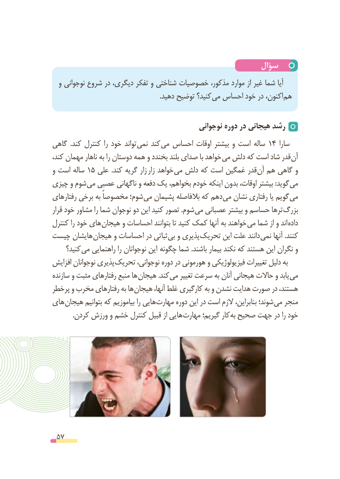

# PDF page 57

سؤال
  و نوجوانی شروع در دیگری، تفکر و شناختی خصوصیات مذکور، موارد از غیر شما آیا
    . دهید توضیح کنید؟ می احساس خود در اکنون، هم

                                            نوجوانی دوره در هیجانی رشد
گاهی  .کند کنترل را خود تواند نمی کند می احساس اوقات بیشتر و است ساله 14 سارا
کند، مهمان ناهار به را دوستان همه و بخندد بلند صدای با خواهد می دلش که است شاد قدر آن
و است ساله 15 علی  .کند گریه زار زار خواهد می دلش که است غمگین قدر آن هم گاهی و
چیزی و شوم می عصبی ناگهانی و دفعه یک بخواهم، خودم اینکه بدون اوقات، بیشتر :گوید می
رفتارهای برخی به مخصوصاً شوم؛ می پشیمان بالفاصله که دهم می نشان رفتاری یا گویم می
قرار خود مشاور را شما نوجوان دو این کنید تصور .شوم می عصبانی بیشتر و حساسم ترها بزرگ
کنترل را خود های هیجان و احساسات بتوانند تا کنید کمک آنها به خواهند می شما از و اند داده
چیست هایشان هیجان و احساسات در ثباتی بی و پذیری تحریک این علت دانند نمی آنها .کنند
     کنید؟ می راهنمایی را نوجوانان این  چگونه شما .باشند بیمار نکند که هستند این نگران و
افزایش نوجوانان پذیری تحریک نوجوانی، دوره در هورمونی و فیزیولوژیکی تغییرات دلیل به
سازنده و مثبت رفتارهای منبع ها هیجان .کند می تغییر سرعت به آنان هیجانی حاالت و یابد می
پرخطر و مخرب رفتارهای به ها هیجان آنها، غلط کارگیری به و نشدن هدایت صورت در هستند،
های هیجان بتوانیم که بیاموزیم را هایی مهارت دوره این در است الزم بنابراین، شوند؛ می منجر
. کردن ورزش و خشم کنترل قبیل از هایی مهارت گیریم؛ کار به صحیح جهت در را خود

 57

